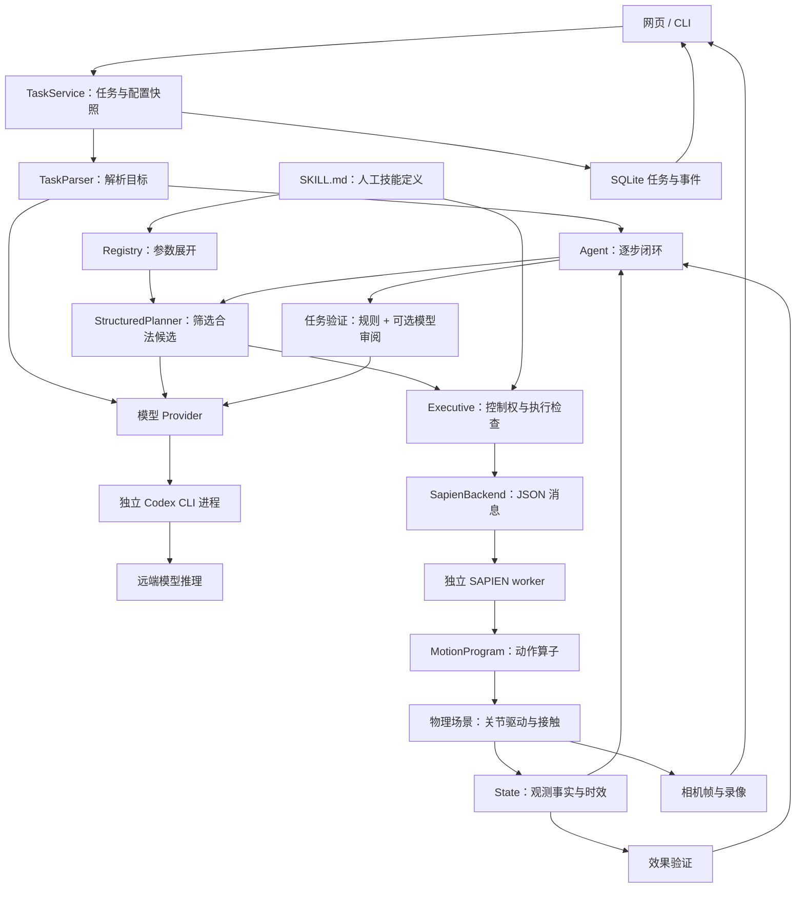

# Primitive VLA Agent

面向 **G1 + Inspire 厨房操作**研究目标的具身 Agent 原型：状态驱动规划、技能契约、确定性执行、可替换动作后端，以及可操作的网页控制台。**当前 Agent 物理后端使用 Franka Panda + SAPIEN，尚未接入 G1/Inspire 真机。通用 π0.5 base 首次自建场景抓取未成功；另使用 LIBERO 专用 π0.5 权重完成了 10 回合独立仿真评测，9 回合成功。**

本次参考 [PhyAgentOS-core](https://github.com/PhyAgentOS/PhyAgentOS-core) 的统一配置、模型接口、任务持久化，以及执行/证据/验证分离设计，保留适合当前六类技能项目的规模。设计对应关系见 [参考与边界](docs/reference.md)。

阅读入口：[Agent + π0.5 闭环演示](docs/libero-agent.md) · [启动网页](#启动网页) · [SAPIEN 物理仿真](#sapien-物理仿真) · [π0.5 独立评测](benchmarks/libero/README.md) · [目录与模块](#目录与模块) · [技术报告](#技术报告) · [Git 与开发约定](docs/development.md)。

## 已跑通：Agent + π0.5 双目标闭环

**[打开 Agent 工作台与真实运行记录](http://127.0.0.1:8084/?task=052395919ad44e08bba8e3512b147bce)**。

输入自然语言“把字母汤罐头和奶油奶酪盒都放进篮子”，Codex 自主解析两个目标，从包含干扰物的候选中先选汤罐头；π0.5 完成搬运并松开夹爪后，Agent 读取新事实，再选择奶酪盒。两个技能在同一物理场景中连续执行，没有重置或预设顺序。

实测 **2 次技能调用均成功、LIBERO 原始总任务谓词成立**，包含 4 次 Codex GPT-5.5 / medium 调用和 49 次 π0.5 推理、239 步物理控制。技能在 `skills/libero/transfer/SKILL.md` 中定义，路径、模型、预算和场景映射在 `configs/libero-agent.json` 中配置。

这是一条真正经过原有 Agent/Executive/Verifier 的路径。下方 9/10 的 LIBERO-Spatial 结果仍是独立策略评测，两者不混用。完整模块分工、真实决策、复现方式与边界见 [Agent 闭环技术报告](docs/libero-agent.md)。

## 启动网页

当前工作区已经安装好 `.venv`，直接运行：

```bash
.venv/bin/python -m primitive_vla serve
```

打开 **http://127.0.0.1:8080**。API 文档在 `/docs`。

新环境安装：

```bash
python3 -m venv .venv
.venv/bin/python -m pip install -e .
.venv/bin/python -m primitive_vla serve
```

Python 3.10+，当前控制台工作区锁使用 Linux/macOS 的 `fcntl`。服务器使用 FastAPI、Uvicorn，模型/机器人 HTTP 通信使用 HTTPX，配置使用 Pydantic。前端是原生 HTML/CSS/JavaScript，不需要 Node 构建、CDN 或外部字体。

## SAPIEN 物理仿真

已接入本机 RoboTwin 环境和 Franka Panda 单臂夹爪，历史脚本控制已完成 **多个物体入碗 → 持棒搅拌 → 工具归位**。当前默认配置切换为 **MOVE_TO 用 IK、局部操作用 π0.5 base**；网页显示仿真、模型动作与验收。VLA 模式尚未完成这条长程任务。

```bash
.venv/bin/python -m primitive_vla serve --config configs/sapien.json --workspace workspace/sapien
```

打开 **http://127.0.0.1:8081**，点击“开始执行”。当前配置使用 **Codex GPT-5.5 / medium** 完成目标解析、逐步技能选择与结果复核；网页并排显示实时仿真画面和决策过程。物体布局、碗与工具位置、驱动参数、相机位置和搅拌参数支持配置；机器人结构、部分几何与验收判据仍固定在代码中，详见下方技术报告。启动路径、物理验收规则和已验证范围见 [SAPIEN 仿真说明](docs/simulation.md)。

## 网页可以做什么

| 页面 | 可操作内容 |
|---|---|
| 操作工作台 | 提交指令或任务 JSON、取消任务、查看目标完成情况、手部占用、场景示意、执行时间线和事实来源 |
| 任务记录 | 查看历史任务、配置快照、执行结果、模型调用元数据和最终验证结论；刷新或重启后记录仍在 |
| 技能契约 | 查看当前加载技能的版本、参数、入口、持续条件、效果、资源、超时和重试上限；厨房 mock 有六类，脚本 SAPIEN 有三类，当前 VLA 库有 MOVE_TO 加三类操作 |
| 配置管理 | 编辑模型、解析器、规划器、验证模式、预算和提示词；完整 JSON 可修改场景、技能、动作后端与网页参数 |
| 视觉输入 | 上传 PNG/JPEG/WebP 作为 VLM 参考图像，或在配置中接入图像 URL；页面显示图像预览 |

默认是 **symbolic mock**：无需 GPU 即可完整运行，但不包含物理仿真或真机控制。页面中的桌面是符号状态示意。上传的参考图像不会自动更新事实；真实感知应由观察器提供。

默认厨房任务执行：

```text
PLACE 勺 → GRASP 杯 → POUR → PLACE 杯 → GRASP 勺 → STIR → PLACE 勺
```

默认 mock 配置的装盒任务会根据当前状态跳过已完成步骤，如盒盖已打开则不重复 OPEN。

## 技能定义在 SKILL.md

技能文件位于 `src/primitive_vla/skills/`，分为 `kitchen/`、历史脚本 `sapien/` 和当前 `sapien_vla/` 三套库。每个技能一个 `SKILL.md`：YAML 定义契约，以及脚本 program 或 VLA policy_prompt，Markdown 正文说明用途和技能衔接。仿真不再使用按技能名称写死的 Python 分支。

- 在配置中用 `skill_sources` 选择目录；内置源为 `builtin:kitchen`、`builtin:sapien`、`builtin:sapien_vla`。
- 修改文件后，下次任务自动加载；网页“技能契约”页可以查看正文并重新加载。
- Python 提供通用规划、执行与底层算子；任务快照保存当次实际加载的技能内容。

详见 [技能文件格式与扩展](docs/skills.md)。

## Codex GPT-5.5 / medium

已通过独立 provider 正式接入本机 Codex CLI，复用已有登录。模型、推理强度、可执行文件路径和调用超时均可在网页配置。GPT-5.5 推理在远端执行，本机负责客户端、Agent 和物理仿真。

网页“模型决策过程”显示目标、输入事实、候选技能、简短选择依据、调用状态、耗时和 token 用量；执行时间线和目标证据记录物理反馈。推理期间相机持续更新，任务结束后可回看录像与决策记录。

接口与运行说明见 [Codex 接入](docs/codex-integration.md)。

## π0.5 底层控制：MOVE_TO → VLA

当前 `configs/sapien.json` 使用本机 `lerobot/pi05_base`，接口与真实仿真动作已经接通：

```text
Codex 选择 MOVE_TO → IK 接近物体，保持夹爪开度
Codex 选择 GRASP / PLACE / STIR
    → SKILL.md 中的操作指令 + RGB + 关节状态
    → π0.5 预测动作块 → 关节/夹爪目标 → 物理观测验收
```

**首次实际结果：MOVE_TO 成功，随后 VLA 执行 12 个动作块、60 步，但没有抓起红色方块。** 没有回退到旧抓取脚本。当前采用官方 Franka 归一化统计和显式的实验动作映射，尚未对 Panda 做训练分布和动作空间标定。

- [查看真实 VLA 试验及录像](http://127.0.0.1:8081/?task=44aefdf56c474c999fe34d0a3b8a1622)
- [VLA 控制技术说明、配置与结果](docs/vla-control.md)
- [试验摘要](workspace/pi05/validation.json)

网页新增“低层控制 · IK → VLA”和动作模型设置。checkpoint、归一化统计路径、动作解释、执行前缀、频率和限幅均可配置。π0.5 使用独立 `vla/` 模型进程；不占用高层 VLM provider 接口。

## π0.5 LIBERO 仿真评测

已下载并实际运行 [LeRobot 的 `pi05_libero_base`](https://huggingface.co/lerobot/pi05_libero_base)。它是 LIBERO 专用版本；官方对应的 [pi05_libero 配置](https://github.com/Physical-Intelligence/openpi/blob/main/src/openpi/training/config.py)从 π0.5 base 微调得到，不能把这里的结果解释为通用 base 在任意 Panda 场景的零样本能力。

**2026-09-15 实测：LIBERO-Spatial 全部 10 个任务，每任务 1 回合，成功 9/10（90%）。** 固定 seed=7、官方初始状态编号 0；失败的是“取出顶部抽屉内的黑碗并放到盘子上”，达到 220 步上限。成功与失败视频全部保存，未重试挑选结果。这是小规模演示评测，不是完整官方 benchmark 成绩。

- **[打开仿真视频与动作报告](http://127.0.0.1:8083/spatial-10/)**：双相机录像、逐回合结果、真实动作曲线、推理日志。
- [评测配置与复现技术报告](benchmarks/libero/README.md)、[原始结果](workspace/benchmarks/libero/spatial-10/results.json)、[执行核对摘要](workspace/benchmarks/libero/spatial-10/validation.json)。

技术链路为：**任务文字 + 外部/腕部相机 → π0.5 → 10×7 动作块 → 执行前 5 步 → LIBERO OSC_POSE 控制器 → MuJoCo/Panda → 重新观测**。7 维动作是末端平移、旋转增量及夹爪控制。没有抓取脚本或物体吸附，成功由 LIBERO 原始任务谓词判定。按照该 checkpoint 的设置，机器人状态只记录、不输入模型；模型输出连续动作，不输出文字思维链。

使用官方 LIBERO 动作分位数统计反归一化，完整严格加载模型，并修正 Hugging Face 通用配置与官方 LIBERO 设置之间的差异：动作时域取 10，禁用离散状态提示。实际执行 1,143 步、232 次模型调用，推理耗时中位数约 **171 ms**（RTX 5090，bfloat16，batch=1）。网页中的曲线和日志来自这些真实调用。

实现集中放在 `benchmarks/libero/`，运行产物集中放在 `workspace/benchmarks/libero/`。路径、模型、任务编号、回合数、种子、时域、控制频率、相机分辨率和输出目录都由 JSON 配置。此评测直接运行低层策略，与 SAPIEN 中的 Codex 高层规划和 MOVE_TO/IK 实验分别验证。

## 本机 Qwen3-VL 4B

本机已经接入缓存中的 4B 权重。启动与配置见 [本地模型说明](docs/local-vlm.md)。

```bash
# 模型服务，在现有模型环境中加载本机权重
PYTHONPATH=src /home/estar/miniconda3/envs/affordance/bin/python \
  -m primitive_vla.providers.local_server --config configs/qwen-server.json

# Qwen 自然语言解析 + 文件化技能 + 网页控制台
.venv/bin/python -m primitive_vla serve \
  --config configs/qwen.json --workspace workspace/qwen
```

打开 **http://127.0.0.1:8082**。该 Qwen 配置让模型解析目标、规则规划器组合技能。SAPIEN 控制台 **http://127.0.0.1:8081** 当前使用 Codex；在设置中选择 HTTP provider 并填写 Qwen 地址与模型名，即可切回本地 VLM。

## 接入 HTTP VLM

在网页“配置管理”中将模型接入选择为 `http`，然后设置：

1. **服务地址**：兼容 `/chat/completions` 的 API 根地址，例如 `http://127.0.0.1:8000/v1`。
2. **模型名**：服务实际提供的模型 ID；需要图像时选择该服务支持的视觉模型。
3. **密钥**：配置环境变量名 `VLM_API_KEY`，或在网页填写仅存于当前服务进程内的临时密钥。
4. 点击“保存并测试连接”。测试会发送配置中的参考图像，并验证 JSON 返回。
5. 将任务解析设为 `vlm`，规划器设为 `vlm`；也可以单独启用其中一个。

客户端支持多图像输入、温度、token 上限、超时、JSON 模式、图像细节与提示词。若服务不接受 `response_format`，可关闭 JSON 模式；返回内容仍需满足程序规定的 JSON 结构。

也可使用文件配置：

```bash
# 先将 configs/vlm.json 中的地址和模型名改成实际服务
export VLM_API_KEY='你的密钥'
.venv/bin/python -m primitive_vla serve --config configs/vlm.json --workspace workspace/vlm
```

配置文件支持部分覆盖；省略内容使用默认值。网页保存的是完整有效配置。密钥不写入配置、任务快照或模型调用日志。

**VLM 的三种用途相互独立：**

- **解析**：自然语言 → 已声明谓词上的目标与依赖。模型不能扩大任务预算。
- **规划**：结构化场景、目标、最近反馈、图像 → 一个合法候选技能索引。
- **验证**：根据事实与图像逐项给出 `success / failure / unknown`，附证据引用，不直接改写机器人状态。

模型失败不会静默切换到规则规划。本机 Qwen 已验证真实图像输入和非模板指令解析；其逐步模型规划仍会出现循环或过度观察，Qwen 示例配置选择规则规划。实测范围与记录见 [本地模型说明](docs/local-vlm.md)。

## 配置与运行记录

首次运行生成：

```text
workspace/
├── config.json       # 可编辑的完整配置
├── tasks.sqlite3     # 任务、事件、配置快照和最终结果
├── media/            # 上传图像、仿真相机帧与录像
├── runs/             # CLI 导出、仿真进程配置与诊断
├── exports/          # 按需导出的任务日志与技术解读
└── .lock             # 防止同一工作区启动多个控制进程
```

配置修改仅对**后续任务**生效。每个任务保留独立快照，历史画面使用当时的事实和配置。网页监听 host/port 修改后需要重启服务。

任务记录采用 SQLite WAL；意外重启后的未完成任务标记为 `interrupted`，不会重放动作。机器人停止未确认或远程执行过程中重启时，工作区保持控制锁定，需由操作者核对实际状态。默认绑定本机地址；当前没有多用户认证，适合本地或 SSH 转发访问。

配置字段说明见 [docs/configuration.md](docs/configuration.md)。

## 命令行与测试

网页运行时请通过网页/API提交任务。同一工作区不允许再启动第二个 CLI 控制进程；独立 mock 实验可使用另一工作区。

```bash
# 运行默认厨房任务，记录也可随后在网页查看
.venv/bin/python -m primitive_vla

# 结构化装盒任务
.venv/bin/python -m primitive_vla --task examples/pack_fruit.json

# 倾倒首次验收未知：重新观察，不能重复倾倒
.venv/bin/python -m primitive_vla --fault uncertain_pour

# 一次抓取未产生效果 / 抓取超时
.venv/bin/python -m primitive_vla --fault missed_grasp
.venv/bin/python -m primitive_vla --fault timeout

# 输出完整默认配置
.venv/bin/python -m primitive_vla init-config --config my-config.json

# 关键集成测试
.venv/bin/python -m unittest discover -s tests -v
```

CLI 另导出 `<workspace>/runs/<时间>/summary.json` 和 `events.jsonl` 便于直接审阅。退出码 `0` 表示任务完成，`1` 表示未完成，`2` 表示启动/配置错误。Playwright 仅用于开发时浏览器验证，不是运行依赖。

## 目录与模块

```text
primitiveVLA/
├── src/primitive_vla/
│   ├── skills/        # SKILL.md 技能库与加载器
│   ├── domain/        # 共享数据结构、观测状态、技能契约
│   ├── agent/         # 任务解析、规划器、闭环 Agent
│   ├── execution/     # 技能生命周期、控制权限、取消与监控
│   ├── backends/      # 后端协议、Mock、HTTP、SAPIEN 进程适配
│   ├── simulation/    # SAPIEN 场景、物理技能与独立仿真进程
│   ├── providers/     # 高层 HTTP / Codex 多模态接口
│   ├── vla/           # π0.5 模型进程、归一化与动作转换
│   ├── verification/  # 技能效果与任务级验收
│   ├── runtime/       # 组件组装、工作区与任务服务
│   ├── config/        # 配置 schema、加载器、defaults/ 内置配置
│   ├── storage/       # SQLite 任务存储、事件日志
│   ├── web/           # HTTP 接口、请求 schema、static/ 网页资源
│   ├── cli.py         # run / serve / init-config
│   └── __main__.py    # python -m 入口
├── configs/           # 可编辑的部署配置示例
├── benchmarks/libero/ # 独立 π0.5 仿真评测：配置、运行器、模型进程、视频报告
├── examples/          # 结构化任务示例
├── docs/              # 架构、配置、后端接入、参考设计
├── tests/integration/ # 核心执行与接口回归测试
├── workspace/         # 运行时生成的数据，不纳入源码
└── pyproject.toml     # 安装依赖、命令入口、资源打包
```

完整文件树、模块依赖和扩展位置见 [架构与目录约定](docs/architecture.md)。CLI 和网页共用 `runtime.service.TaskService`；运行时不依赖网页框架。默认配置随 Python 包安装，部署覆盖放在 `configs/`，运行数据统一进入指定工作区。

## 技术报告

本节记录最初脚本控制基线的设计与九步成功日志，避免将旧成功记录误归因给 VLA。当前 MOVE_TO + π0.5 实现以[最新 VLA 控制报告](docs/vla-control.md)为准；状态管理、技能契约、高层规划与停止机制继续复用。

### 1. 系统定位与已实现范围

脚本基线采用分层设计：**模型产生任务目标并选择技能，程序限定可执行范围，动作后端完成运动，观察器提供证据。** 这使规划、物理执行和成功判定能够分别检查、替换和调试。

| 层级 | 当前实现 | 尚未实现或未验证 |
|---|---|---|
| 高层决策 | Codex GPT-5.5 / medium 多模态解析、逐步规划和审阅；HTTP VLM 可替换 | 任意任务或任意场景的泛化能力 |
| 技能层 | 独立 SKILL.md；参数、入口、持续条件、效果与动作程序 | 自动发现、学习或生成新技能 |
| 动作层 | 基线：IK 脚本；当前：MOVE_TO 用 IK，π0.5 直接产生操作关节目标 | Panda 策略适配成功、RL 策略、通用避障规划 |
| 观测层 | SAPIEN 位姿、关节状态、接触与 RGB | 从相机独立估计对象身份、位姿和任务状态 |
| 交互层 | 网页任务提交、取消、图像、决策摘要、事实表与录像 | 多用户权限管理、远程生产部署 |
| 硬件层 | RoboTwin Panda 资产的物理仿真 | G1 + Inspire 真机驱动与硬件验证 |

内置 `kitchen` 库包含 GRASP、PLACE、OPEN、CLOSE、POUR、STIR，主要用于符号 mock 的执行闭环验证；`sapien` 库包含实际执行的 GRASP、PLACE、STIR。不能将 mock 中的六种技能理解为六种都已完成物理实现。

### 2. 端到端数据流与进程边界



主服务在 `.venv` 中运行，负责 API、任务生命周期、规划与日志；仿真在配置指定的 RoboTwin Python 环境中运行，通过标准输入/输出的 JSON Lines 交换命令和结果。每次 Codex 调用另启动一个临时 CLI 进程，使用参数数组和标准输入传递请求。

同一工作区只允许一个任务占用执行服务。任务启动时冻结配置并加载技能，运行期间修改设置只影响后续任务。每个 SAPIEN 任务创建新的物理场景；运行结束后关闭 worker，页面保留最后观测与录像，不会在后台永久保留可交互场景。

### 3. 模块职责与核心数据结构

| 模块 | 输入 → 输出 | 关键职责 |
|---|---|---|
| [配置加载](src/primitive_vla/config/loader.py) | JSON / 默认值 → AppConfig | 参数合并、技能源加载与配置保存 |
| [技能加载](src/primitive_vla/skills/loader.py) | SKILL.md → SkillSpec | YAML 契约与 Markdown 正文解析 |
| [任务服务](src/primitive_vla/runtime/service.py) | 用户请求 → 任务 ID / 报告 | 工作区锁、配置快照、任务和取消管理 |
| [运行时](src/primitive_vla/runtime/session.py) | 配置 → 组装后的 Agent | 选择后端和 provider，分配任务预算，刷新观测 |
| [任务解析](src/primitive_vla/agent/task_parser.py) | 指令、事实与技能 → Task | 生成或读取目标，检查谓词、依赖及预算 |
| [状态管理](src/primitive_vla/domain/state.py) | Observation → 当前事实 | 时间戳、有效期、可信度和状态版本管理 |
| [技能注册](src/primitive_vla/domain/skills.py) | 技能与对象类型 → Candidate 集合 | 参数组合展开、契约绑定与条件判断 |
| [规划](src/primitive_vla/agent/planner.py) | 状态、剩余目标、候选 → Decision | 规则搜索或 VLM 选择；模型不能指定列表外的技能 |
| [闭环](src/primitive_vla/agent/loop.py) | Task 与反馈 → 下一次规划 / 结束 | 一次选择一个技能，限制步骤、观察和尝试次数 |
| [执行管理](src/primitive_vla/execution/executive.py) | SkillCall → SkillResult | 控制权、入口检查、监控、停止和效果验收 |
| [仿真适配](src/primitive_vla/backends/sapien.py) | 调用与 program → worker 消息 | 隔离 Python 环境、派发动作、接收反馈 |
| [物理动作](src/primitive_vla/simulation/motion.py) | program、绑定、世界状态 → 关节目标 | 解释动作算子，计算几何点、插值与 IK |
| [场景观察](src/primitive_vla/simulation/scene.py) | 位姿、接触、关节 → Observation | 计算语义事实，渲染图像与记录物理证据 |
| [任务验收](src/primitive_vla/verification/task.py) | 目标、报告与状态 → 验收结论 | 规则判定及可选 VLM 审阅，不修改世界状态 |
| [模型通信](src/primitive_vla/providers/factory.py) | purpose、上下文与图像 → JSON | HTTP/Codex 切换、输出结构、超时与资源回收 |
| [存储](src/primitive_vla/storage/tasks.py) / [网页](src/primitive_vla/web/app.py) | 事件与快照 → 持久化 / 可视化 | 记录、查询和展示，不承担物理推断 |

共享结构位于 [domain/models.py](src/primitive_vla/domain/models.py) 与 [domain/skills.py](src/primitive_vla/domain/skills.py)：

- **Fact**：三值真值 `true/false/unknown`，附来源、时间戳、可信度与 TTL。时效或可信度不满足时按 unknown 使用。
- **Observation**：事实、图像引用、本体状态和传感器来源的集合。
- **Task / Goal**：指令、目标谓词、`after` 依赖、禁止技能与执行预算。
- **SkillSpec / Candidate**：人工技能契约，以及将参数绑定到具体对象后的可执行候选。
- **SkillCall**：技能名称、版本、对象绑定、状态版本、调用 ID 与截止时间。
- **SkillResult**：分别记录 execution 和 effect，并附证据与状态变化。`execution=completed` 不自动推出 `effect=success`。

`after` 当前通过技能预期效果和前置目标的当前事实约束派发；它不是独立的历史时序逻辑验证器。系统也没有完整的任务进度自动机或持久化“目标曾经完成”账本。

### 4. VLM 推理与人为定义的边界

| 内容 | 本次来源 | 是否支持配置或编辑 |
|---|---|---|
| 目标分组、目标条件、先后依赖 | VLM 解析用户指令 | 提示词可编辑，输出限制在已声明的谓词内 |
| 当前有哪些对象及其 ID/类型 | 场景配置 | 可编辑，但需与仿真对象和技能契约一致 |
| 物体在哪里、是否持有、是否入碗 | 仿真位姿与接触计算 | 部分阈值可配置，计算规则固定 |
| 当前有哪些合法候选 | 程序枚举与契约筛选 | 技能契约可编辑，枚举/筛选算法固定 |
| 从候选中选哪一步、简短选择依据 | VLM 返回 action/index/reason | 模型、推理强度、规划提示词可配置 |
| 抓取和放置的动作顺序 | SKILL.md 的 program | 人工编辑，不由 VLM 在线生成 |
| 末端轨迹、IK、夹爪开合 | Python 动作算子 | 部分运动参数可配置，算法固定 |
| 技能是否产生预期效果 | 程序比较新鲜观测与契约 effects | effects 可编辑，比较机制固定 |
| 最终逐目标审阅 | VLM 读取事实、执行结果和图像 | 可选择 rules/audit/enforce |
| 资源互斥、停止确认、去重 | 确定性执行代码 | 不交给模型临时决定是否遵守 |

**文件化不等于自动学习，参数化也不等于完全通用。** 修改搅拌半径不需要改算法；更换夹爪结构、抓取姿态策略或物理成功判据，仍可能需要改代码。

模型在规划时收到技能的 `name/version/description/instructions`、候选绑定与效果、当前事实、剩余目标、预算和最近结果。完整 YAML `program` 由执行器使用，并不是模型逐条生成的动作。`capability` 当前主要用于描述能力及提供模型上下文，不是经过学习或标定的技能成功率评分器。

### 5. 历史脚本实例：VLM 如何让模拟器抓取红色物体？

#### 5.1 候选与模型返回

程序根据对象类型和入口条件构造候选。以下省略与说明无关的字段，索引只对当次请求有效：

```json
{
  "candidates": [
    {"index": 0, "skill": "GRASP", "bindings": {"object": "red", "source": "table", "hand": "right"}},
    {"index": 1, "skill": "GRASP", "bindings": {"object": "green", "source": "table", "hand": "right"}}
  ]
}
```

VLM 返回类似 `{"action":"skill","index":0,"reason":"先抓取红色配料以便放入碗中。"}` 的结构化决策。StructuredPlanner 将索引还原成候选，Agent 创建 `SkillCall`；模型没有输出物体三维坐标、抓取姿态或关节角。

#### 5.2 契约检查与消息派发

GRASP 的参数、入口、效果和程序来自 [grasp/SKILL.md](src/primitive_vla/skills/sapien/grasp/SKILL.md)。例如，入口要求手空闲、来源位置已确认、目标可达；期望效果是持有目标并使手不再空闲。

执行器取得控制权后重新观察并检查入口。通过后，SAPIEN 后端实际发送：

```python
await self.request(
    "run",
    call=asdict(call),
    generation=lease.generation,
    program=candidate.spec.program,
)
```

这会成为一条带 `op="run"` 的 JSON 消息。worker 创建 `motion.run(program, call["bindings"])` 迭代器，在控制循环中逐步推进。技能和参数选择与底层动作程序因此保持分离。

#### 5.3 通过物体 ID 定位

场景创建时建立 `world.objects[物体ID]` 映射。动作程序将 `{object}` 替换成 `red`，几何算子读取：

```python
actor = world.objects[step["object"]]
point = actor.pose.p.copy()
```

这里取得的是仿真器内物体的实时准确位置。`red` 的身份来自配置，**不是模型根据颜色检测后新建立的身份**；抓取点也不是从 RGB 预测得到的。工具对象还使用预先实现的高度偏移。

#### 5.4 动作生成与物理抓取

GRASP 的人工程序顺序为：

```text
计算抓取点 → 打开夹爪 → 移至目标上方 → 下降
          → 闭合夹爪 → 检查双侧接触 → 抬升 → 再检查持物
```

`move` 算子在起终点之间生成平滑轨迹，通过逆运动学 IK 求关节角，再由关节驱动跟踪目标。这里的 IK 是“根据末端目标求关节配置”，不包含通用避障路径搜索。夹爪依靠物理接触和摩擦持物，没有把物体附着到手上的约束。

`holding` 使用两侧夹爪接触作为判据，抬升后再次检查。执行器最后还会把新鲜观测与 `holding:right:red=true`、`free:right=false` 等效果逐项比较；找不到接触、滑落或事实不足时，不能仅凭动作程序结束宣布抓取成功。

### 6. 模型接入、观测时效与执行生命周期

`ModelClient.complete(purpose, prompt, context, images)` 是解析、规划和验收共用的接口。HTTP provider 调用兼容 Chat Completions 服务；Codex provider 使用已有登录，每次调用创建临时目录和独立 CLI 进程，传入 JSON Schema、上下文和图像，并在结束、取消或超时后回收进程与临时文件。

Codex 输出 schema 分别限制：目标解析的谓词和值、规划的 action/index/reason、验收的 criterion/status/evidence_refs。解析阶段在线路上使用谓词列表表示条件，provider 再转换为领域模型使用的字典。结构化格式限制只保证接口形状，任务谓词、依赖和候选索引仍需要程序校验。

每次请求独立组织上下文，尚未采用持续 App Server 会话或模型记忆。最近动作结果由 Agent 显式放入下一次请求，因此历史长度和重复上下文会影响开销。

SAPIEN 非事件事实目前只有 5 秒有效期，而本机实测模型调用经常超过 10 秒。`execution.observation_poll_s=0.5` 使模型等待期间继续读取相机和状态，避免画面冻结及事实过期；它不等同于规划器主动请求重新观察，也不消耗 `max_observations`。决策仍需在派发前重新检查入口条件。

执行过程的关键边界：

1. **派发前**：检查技能与参数、状态版本、截止时间、资源和新鲜入口条件。
2. **执行中**：监控契约 invariants、取消、超时与后端健康反馈。不同技能的持续条件可能不同，例如 STIR 要求持续持有工具。
3. **执行后**：读取新观测，区分动作状态与物理效果，不把声明的 effects 直接写入世界状态。
4. **异常停止**：先撤销旧控制代次，向后端请求停止；未确认时保留控制锁。
5. **后续规划**：按技能版本和绑定累计尝试；不可逆技能一次任务内最多尝试一次。本次三种 SAPIEN 技能均配置 max_attempts=1。

这些机制是本原型的执行约束，不应被描述为已经具备真机所需的完整独立安全系统。

### 7. 仿真观测、验收与视觉能力的区别

当前 facts 的主要来源标记为 `sapien:contacts_and_poses`：

| 事实 / 指标 | 当前计算方式 | 解释边界 |
|---|---|---|
| holding | 物体与左右两侧夹爪均有接触 | 持物的简化判据，不是完整抓取稳定性评估 |
| ready | 直接复用 holding | 没有额外学习技能入口可执行性 |
| at:object:bowl | 实际位置落在碗的几何范围内且未被持有 | 读取仿真真值，不是视觉定位 |
| reachable:object | 物体平面距离小于固定阈值 | 不是完整 IK 或碰撞可达性验证 |
| reachable/accepts 的固定设施项 | 对碗、桌面、工具区设置为 true | 场景假设，不是模型判断 |
| healthy | 关节数值均为有限数 | 不覆盖碰撞、力矩异常等完整安全条件 |
| event:stirred:bowl | 累计工具运动角度和接触步数达到阈值 | 表明规定运动/接触发生，不证明物料混匀 |

SAPIEN 事实 confidence 当前固定为 1，不能解释为已标定的视觉概率。模型虽接收相机图像，也同时接收上述真值，因此这次任务成功不能单独证明视觉感知能力；需要去除或扰动真值输入等独立实验才可评估视觉贡献。

技能级验收始终由观测和规则完成。任务级 `rules` 使用事实；`audit` 增加模型审阅但不改变规则成功结论；`enforce` 还要求模型确认全部目标。本次日志使用 `audit`。模型能直接引用已提供的成功事实，其审阅不属于独立于仿真真值的视觉验收。

### 8. 历史脚本完整任务与日志解读

以下数据来自 **2026-09-15 的任务 `920afb72c5434d3d8c96d43ab629b0ab`**，不将单次运行统计当作基准性能或通用成功率。

用户指令：“把所有配料放入碗里，然后搅拌并放回工具”。Codex 在事件 `#392` 生成三组目标：红/绿/黄配料入碗；在入碗之后完成搅拌；在搅拌之后将工具放回工具区。本次使用 VLM 解析，未走模板解析分支。

| 步骤 | 模型选中的技能 | 程序提供的合法候选数 | 模型调用耗时 |
|---|---|---:|---:|
| 1 | GRASP red | 4 | 8.000 s |
| 2 | PLACE red → bowl | 2 | 10.835 s |
| 3 | GRASP green | 3 | 22.399 s |
| 4 | PLACE green → bowl | 2 | 15.318 s |
| 5 | GRASP yellow | 2 | 14.206 s |
| 6 | PLACE yellow → bowl | 2 | 10.500 s |
| 7 | GRASP stirrer | 1 | 8.846 s |
| 8 | STIR bowl | 2 | 12.166 s |
| 9 | PLACE stirrer → tool_home | 2 | 24.673 s |

九步顺序没有作为固定任务动作序列传给执行器，而是每步根据状态重新选出。但这个空间受到人工技能和程序筛选的强约束：第 7 步仅有一个合法候选；“所有配料先入碗”也受到 STIR 人工入口条件约束。红→绿→黄的单次选择不能证明模型优化了操作顺序，配置中的对象枚举顺序可能影响选择。

| 统计项 | 本次记录 |
|---|---:|
| 任务总墙钟时间，含初始化与收尾 | 212.843 s |
| 模型调用 | 11 次：解析 1、规划 9、审阅 1 |
| 模型调用耗时之和，含 CLI 开销 | 157.782 s |
| 技能执行 / 效果成功 | 9 / 9 |
| 主动重新观察 | 0 次；后台观测仍持续进行 |
| 最终状态 / 模型 audit | completed / success |
| 原始事件数 | 125 |
| CLI 报告输入 / 输出 tokens 合计 | 200,986 / 1,684 |

Token 数包含 CLI 自带上下文等开销，不等于用户指令长度，也不直接等于费用。各阶段时间可能与后台仿真、观测重叠，不应将“总时间减模型时间”当作纯动作执行耗时。

原始事件的阅读方式：

| 事件 | 用来回答的问题 |
|---|---|
| model_requested / model_response | 给了模型哪些已记录输入？模型返回了什么？ |
| decision | 模型索引最终映射到哪个技能与对象绑定？ |
| acquired / checked | 哪个后端取得哪些资源？入口检查是否通过？ |
| feedback | 动作正在 approach、grasp、lift 还是其他阶段？ |
| result | 动作状态和效果状态各是什么？有哪些观测证据？ |
| task_finished / task_verdict | 规则目标是否完成？最终模型审阅如何？ |

本机查看与导出材料：

- [网页回看本次任务](http://127.0.0.1:8081/?task=920afb72c5434d3d8c96d43ab629b0ab)
- [完整导出包，含录像](workspace/sapien/exports/920afb72c5434d3d8c96d43ab629b0ab.zip)
- [日志阅读入口](workspace/sapien/exports/920afb72c5434d3d8c96d43ab629b0ab/README.md)、[逐步解读](workspace/sapien/exports/920afb72c5434d3d8c96d43ab629b0ab/timeline.md)、[步骤 CSV](workspace/sapien/exports/920afb72c5434d3d8c96d43ab629b0ab/steps.csv)
- [原始事件](workspace/sapien/exports/920afb72c5434d3d8c96d43ab629b0ab/events.jsonl)、[配对模型调用](workspace/sapien/exports/920afb72c5434d3d8c96d43ab629b0ab/model_calls.json)、[任务和配置快照](workspace/sapien/exports/920afb72c5434d3d8c96d43ab629b0ab/task.json)

这些 workspace 链接属于本机运行产物，新安装不自带历史日志。网页可通过“本次任务配置快照 → 导出完整任务记录”导出任务和事件 JSON；上面的 ZIP 是另行整理的日志、解读与视频包，网页导出按钮不会自动打包录像。

**记录限制**：模型事件保存输入摘要、最终结构化输出和简短依据，没有内部思维链、完整 CLI 诊断、逐次完整提示词或精确图像帧映射。`model_calls.json` 是已有事件的配对视图，不能作为完整请求的精确重放输入。`seq` 为数据库全局序号，不是单任务行号。任务保留技能和配置快照，但本次源码没有提交哈希，因此不能以版本库证据证明历史 Python 与当前源码逐字一致。

### 9. 脚本基线的可配置范围与固定假设

| 位置 | 支持修改 | 仍然固定或耦合的内容 |
|---|---|---|
| 网页 / JSON 的模型配置 | provider、model、effort、路径、超时和图像预算 | CLI 调用结构、JSON schema；部分附加提示词写在 Python 中 |
| JSON 的仿真配置 | 物体位置/颜色、碗尺寸、工具位置、相机位置、驱动与搅拌参数 | Panda URDF 子路径、链接名、初始姿态、桌面和工具部分几何 |
| SKILL.md | 技能参数、条件、效果、资源、超时、说明与动作组合 | 动作和契约仍由人编写；新算子需要 Python 实现 |
| STIR 契约 | 可编辑入口谓词与 program | 目前直接列出 red/green/yellow；program 还要求所有配置配料入碗 |
| MotionProgram | 从配置或 program 读取部分速度、半径、圈数 | 固定末端姿态、插值、IK 参数、开合幅度及几何特例 |
| Scene.observe | 部分尺寸和任务阈值来自配置 | holding/ready/healthy/reachable 判据、confidence=1、非事件 TTL=5 秒 |

尤其需要注意：新增或重命名配料时，仅编辑 `scene.objects` 不够，需要使物理对象、事实词表与技能条件一致。当前 STIR 也无法仅凭自然语言自动变成“只搅拌指定子集”的通用技能。

配置中的 HTTP `base_url`、API Key、temperature、max_tokens、json_mode、image_detail 用于 HTTP provider，不能理解为同样控制 Codex CLI 的对应行为。详细有效字段见 [配置说明](docs/configuration.md)。

### 10. 脚本基线的验证范围与技术路线

截至本次接入验证，自动测试运行 26 项，其中 **25 项通过、1 项 GPU 仿真取消测试默认跳过**。测试覆盖核心执行边界、取消、观测时效、技能重载、HTTP 接口、Codex 子进程协议与异常回收。Codex 自动测试使用模拟 CLI 子进程，真实模型与物理仿真的证据来自上述独立完整运行；二者不能混称为全部真实模型测试。

浏览器已检查相机更新、决策卡片、模型标识、设置页、持久化回看和录像访问，未出现 JavaScript 错误；移动端检查无横向溢出。这些检查说明当前界面可用，不代表复杂任务规划、视觉感知或真机能力已经验证。

后续扩展建议按依赖关系推进，以下为基线阶段的路线；第 4 项已接通 base 推理与动作，物理操作成功仍待验证：

1. **消除场景耦合**：把固定配料名改为任务/场景集合表达，拆出机器人描述和几何适配器。
2. **补齐可追溯记录**：记录每次调用的完整公开请求上下文、图像引用与源码版本；继续排除内部思维链和凭据。
3. **独立验证视觉观察器**：将 RGB 感知输出与仿真真值分开，对照评估身份、位姿、持物和目标状态。
4. **适配学习型动作策略**：SkillCall→π0.5 动作接口已接通，继续标定动作空间、微调并评估物理成功率；保留观测验收与停止确认。
5. **减少不必要的模型调用**：评估单候选直接选择、上下文裁剪或持续会话，测量延迟和规划质量的变化。
6. **扩展任务与硬件验证**：在随机布局、失败恢复和遮挡等条件下评估，再实现 G1/Inspire 适配与驱动侧监控。

## 保留的执行边界

- 事实带来源、时间、可信度和有效期；UNKNOWN 不通过启动检查。
- 规划中的假想效果不写入观测状态；执行完成与效果成功分开。
- 入口、持续条件和终点效果各在对应阶段检查。
- 调用去重，动作/反馈按 `call_id + generation` 隔离；停止需要后端确认。
- 释放控制权不会清空持物事实；POUR/STIR 在一次任务中每个绑定最多尝试一次。
- `rules` 使用事实验证；`audit` 增加 VLM 审阅；`enforce` 要求事实与 VLM 均通过。任何模式都不绕过技能级检查。

π0.5 的 Panda 任务适配、G1/Inspire 驱动、视觉感知、真机适配的 IK/碰撞检测及独立驱动侧 watchdog 仍需继续实现；当前已有的 Panda 仿真 IK 不等于这些真机能力已经完成。HTTP 后端使用本项目明确的小型协议，**不声称与 PhyAgentOS Forge 协议直接兼容**。接口见 [docs/backends.md](docs/backends.md)。

## Mem-0 / RMBench 长序列接入

新增 `cover_blocks` 配对实验：现有 Agent 通过 `SKILL.md` 和 Executive 调用 Mem-0 executor，底层运行双臂 Aloha / SAPIEN。支持全 VLA 与 IK 接近后 VLA 两种模式，保留独立物理效果验证、动作日志和网页回放。部署、实验边界及运行入口见 [benchmarks/mem0/README.md](benchmarks/mem0/README.md)。
