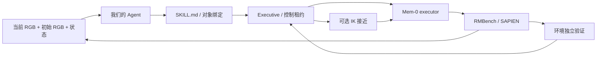

# Agent → Mem-0 → RMBench

本机实测及失败记录见 [RESULTS.md](RESULTS.md)。IK 接近 → VLA 已完成六阶段整任务：
6 次 IK、885 个 VLA 动作、6 次 Agent 规划。少量 smoke test，尚不构成正式 benchmark 复现。

本实验将项目现有 `Agent + StructuredPlanner + Executive` 接到 RMBench 的
`cover_blocks` 与 `battery_try`。使用发布的任务专用 Mem-0 executor，**不是 π0.5，也不是官方 Planner**。

## 职责与目录

| 层 | 实现 | 职责 |
|---|---|---|
| 高层规划 | 现有 `agent/`、`providers/` | Codex gpt-5.5 medium 根据图像、事实和候选技能选下一步 |
| 技能契约 | `skills/rmbench/{cover,uncover}/SKILL.md` | 参数、前后条件、资源、超时和模型提示词 |
| 中间层 | 现有 `execution/` + `backends/rmbench.py` | 授权、调用、撤销、效果验证和控制权交接 |
| VLA | `vla/mem0.py` | 官方视觉编码、MemoryBank、结束分类器、flow-matching 动作头和归一化 |
| 仿真 | `simulation/rmbench_worker.py` | 持续存在的 SAPIEN 世界，执行 Aloha 14 维关节目标 |
| 实验入口 | 本目录 `run.py` | 配对种子评测及日志，不绕过现有 Agent |
| 大文件 | 忽略目录 `workspace/mem0/` | 上游源码、依赖、权重、资产、视频和运行日志 |



`cover_blocks` 的任务规格固定为六个有先后约束的目标，本实验不评测自然语言任务解析。
Agent 每次执行后重新规划；初始 RGB 作为显式视觉记忆保留，颜色与位置绑定由
Agent 读图决定。环境内部的未来目标状态序列不提供给规划器。
物理状态机提供当前事实，因此这也不是纯视觉成功验证实验。

## 两种控制模式

- `vla`：从当前姿态开始，接近、抓取、放置都由 Mem-0 预测动作。
- `ik_approach`：Agent 选定盖子后，CuRobo IK/运动规划执行官方抓取程序的**第一条
  pre-grasp move**，不执行其抓取、夹爪或放置步骤，再交给同一个 Mem-0 模型。

控制模式由评测配置固定，当前不评测 Agent 自主选择 IK 或 VLA。

IK 使用仿真中的真实物体位姿，是带特权信息的对照。两种模式均不瞬移、不重置
子任务世界、不调用完整专家轨迹。IK 接近可能使输入偏离 executor 的训练分布，
其效果不能预设优于 VLA。IK 的轨迹耗时单独记录；`control_steps` 仅计 VLA 外层
动作，不包含 IK 内部物理步，不能直接作为两种模式总运动成本的公平比较。

执行器的结束分类器保留。分类器结束不等于技能成功，Executive 还会检查物理
后置条件。预测返回后再次检查控制租约，已撤销的动作不会下发；已下发的批次
最多执行 8 个动作后处理停止。本适配器用于仿真，不是实时真机控制接口。

## IK→VLA 的记忆交接与 Agent 恢复

`handoff_memory=pre_approach` 在 IK 前建立视觉 anchor，移动后更新当前观察，
避免将已经接近物体的画面误当成技能初始场景。`post_approach` 保留旧方式，供消融。
这里没有给模型输入专家抓取动作，也没有修改权重。

`agent_supervision=true` 时，中间层在以下事件暂停动作并请同一个 Codex Agent 决策：

- 结束分类器触发，但技能后置条件未满足；
- 已执行 `review_interval_steps` 步，目标仍未确认完成。

Agent 读取当前/初始 RGB、物理事实和本次执行反馈，从 `continue`、`reapproach`、
`stop` 选择一个（全 VLA 模式禁用 `reapproach`）。`continue` 保留视觉记忆，只清除已处理的结束票；`reapproach`
只重新执行目标盖子的 IK 接近；`stop` 经 Executive 停止并释放控制。
提示词在 [prompts/handoff.md](prompts/handoff.md)，技能边界在对应 `SKILL.md`。
每技能的恢复次数由 `max_reviews_per_skill` 限制，总动作和超时预算仍生效。

初次 IK 仍由实验模式指定；Agent 自主选择的是恢复动作和对象绑定。基于视觉的
空夹爪判断不是经过验证的真机抓持检测。物理状态机为仿真特权反馈。

验证 Agent 增量时，至少固定权重、种子、渲染、动作预算与记忆方式，仅切换
`agent_supervision`。新旧整套实现的差异不能单独归因于 Agent。
`handoff_calls` 与 `handoff_review` 分别记录真实模型调用数及实际恢复选择。

## 来源与实验边界

- [RMBench 官方源码](https://github.com/RoboTwin-Platform/RMBench)，固定 commit
  `e43d39ff102ccc4c800c24e0ec54e51c94673822`。
- [Mem-0 发布权重](https://huggingface.co/qiuly/Mem-0-mn-RMBench)，固定 revision
  `b08bad88132ec7a232b707ed784cc6c14f0e7c33`。
- 使用 `cover_blocks/final_step30000.pt` 和其对应 `norm_stats.json`，下载后校验
  发布的 SHA256，严格匹配全部模型键。checkpoint 含训练优化器，磁盘约 15.3 GB。
- 官方 model card 的 76% / 100 episodes 是发布结果，**不是本地结果**。官方采用
  专家可解性筛选种子；本实验直接使用指定种子，标注为 smoke test。
- 本机 RTX 5090 使用 Torch 2.9 / CUDA 12.8 / Transformers 4.57.1 / SDPA；
  `patch_upstream.py` 从 Qwen 配置构建模型，再由完整 checkpoint 加载参数，避免
  重复加载基础权重。动作头输入显式转成其参数 dtype，修复 BF16→FP32 不匹配。
  这些兼容性改动意味着不是官方环境的逐位复现。

## 运行

当前机器的路径在 `config.json` 中。仿真与模型依赖隔离在
`workspace/mem0/.venv`，主项目依赖不安装大型仿真或模型包。

```bash
.venv/bin/python benchmarks/mem0/run.py \
  --output workspace/mem0/evaluation \
  --seeds 100000 100001 --modes vla ik_approach
```

输出目录必须是新目录，防止覆盖旧结果。每轮会留下：

- `summary.json`：真实环境成功、阶段、奖励、步数、模型/Agent 调用数及错误。
- `events.jsonl`：Agent 请求与结构化响应、技能决策、验证和控制生命周期。
- `physics.jsonl`：实际执行的模型动作、结束分类器、IK 目标与前后姿态。
- `media/rollout.mp4`、初始图像与逐步图像。
- `worker.log`：仿真、模型和底层库错误。

仅将 `physical_success=true` 计为成功。启动错误、超时和效果未达成都保留，不能
删除失败种子后重新计算。少量配对测试不能估计 benchmark 稳定成功率。

### 重建本机依赖

依赖已有可运行 SAPIEN/CuRobo 的 RoboTwin Python 环境。以下不会修改原环境：

```bash
/home/estar/miniconda3/envs/robotwin/bin/python -m venv --system-site-packages workspace/mem0/.venv
workspace/mem0/.venv/bin/pip install transformers==4.57.1 omegaconf qwen-vl-utils diffusers timm numpy==1.26.4
workspace/mem0/.venv/bin/python benchmarks/mem0/prepare_assets.py \
  --robotwin-assets /home/estar/czx/RoboTwin/assets
```

资产脚本下载本任务盖子和 Aloha；共享的背景、通用物体目录链接到现有 RoboTwin
资产。换机器需要提供真实存在的资产路径，并准备 CuRobo、mplib、SAPIEN 等原环境
依赖。本机完整环境包版本保存在 `workspace/mem0/environment-packages.txt`。

网页查看（只读，不触发机器人动作）：

```bash
.venv/bin/python -m http.server 8085 --bind 127.0.0.1 --directory workspace/mem0
```

打开对应运行目录，例如 `http://127.0.0.1:8085/smoke-01/`。

## 如何读日志

| 事件 / 字段 | 含义 |
|---|---|
| `model_response`，`purpose=plan` | 高层 Agent 的真实调用、合法候选索引和简短理由 |
| `controller_selected` | 技能与对象绑定转成的 executor 文本 |
| `vla_response.actions` | Mem-0 预测的动作，经官方归一化逆变换和 16→14 维布局转换 |
| `vla_response.elapsed_s` | **仅动作头推理**，不含视觉编码，不是端到端 VLA 延迟 |
| `vla_chunk_executed.elapsed_s` | 一批物理动作及逐步视觉编码、MemoryBank / 结束分类器更新 |
| `physics.jsonl` 的 `ik_approach` | IK 目标、移动前后关节状态、耗时；明确标记真实仿真位姿来源 |
| `result.execution` | 执行器是否正常结束、失败、取消或超时 |
| `result.effect` | 独立物理观察是否满足技能后置条件 |
| `physical_success` | 官方环境是否完成整个六阶段任务，最终成功指标 |

覆盖顺序、目标先后关系和动作格式属于 benchmark / 适配器规格；技能提示词和
契约在 Markdown 中。Agent 预测的是下一技能与对象位置绑定，Mem-0 预测的是连续
关节动作与结束信号。IK 使用确定性的几何控制接口。成功状态来自环境，既不由
Agent 自报，也不会把 SKILL.md 声明的效果直接写成事实。

加载器记录的约 23.58 亿是去重后的参数数量；checkpoint 张量元素计数约 26.69 亿，
包含共享存储的 token embedding 与 lm_head 两个键。两者计数口径不同。

状态中 `covered:*` / `uncovered:*` 表示官方状态机已完成的历史阶段；
`cover_on:*` 表示当前盖子是否仍覆盖对应积木，二者用途不同。

### 本机兼容性与中断诊断

`head_camera_only=true` 关闭 executor 不使用的腕部、第三视角图像采集；头部
相机位置、分辨率、渲染方式保持原设置。本机试跑的初始头部 PNG 在修改前后
SHA256 完全一致。此选项同时降低渲染工作量；仍需在相同选项下比较两个模式。

第一轮 IK 在第二次接近后的第 99 个动作附近停止推进，最后保存帧为第 98 步。
无法确认根因，不能当作 IK 操作失败；该次的原始记录保留为基础设施中断。
后续 worker 支持 `SIGUSR1` 输出 Python 线程堆栈，便于定位阻塞。
若最终观察失败，`final_observation_available=false`，报告中的物理状态仅为末次
可用观察；`control_locked=true` 表示停止未确认，不能将其视为正常交接。

官方 `joint_action.vector` 读取的是关节驱动目标，非独立实测关节编码器值。
适配器按官方观测约定使用它；物理成功另由环境中的实际物体位姿判定。
IK 视频目前只记录接近前后帧，完整轨迹由 `env.move` 在物理仿真内执行。

### RTX 5090 渲染后备模式

第三轮在第 703 个动作再次阻塞；堆栈明确停在
`envs/camera/camera.py:336 -> camera.get_picture("Color")`。
关闭未使用相机只绕过了前一次阻塞，**没有解决光追模式的稳定性问题**。
上游有 [Blackwell / SAPIEN 3.0.0b1 同类报告](https://github.com/RoboTwin-Platform/RoboTwin/issues/477)，
但这不是对本机底层驱动根因的确认。

历史 smoke-04 使用 `camera_shader="default"`、`denoiser="none"`，在创建相机之前生效。
这使用普通栅格渲染，图像外观不同于官方光追设置，必须独立标注结果。
需要原始光追路径时可配置 `camera_shader="rt"`、`denoiser="oidn"`；本机此前已
证明该路径能完成一次 VLA 整任务，但无法稳定完成连续评测。
当前本机配置为 `camera_shader="rt"`、`denoiser="none"`，启用下述 CUDA 读取与
快速视觉投影。所有尝试保留在 `workspace/mem0/smoke-*`，不静默丢弃中断。

### 可选的 Blackwell 视觉投影兼容路径

`linear_patch_embed=true` 将 Qwen 已切分好的单个 C×T×H×W patch 的 Conv3D
投影改为同一权重展平后的矩阵乘法。只改变计算方式，不修改模型权重、视觉
输入或 action head；BF16 舍入可能不同，因此比较组必须使用相同设置。
默认未配置时保留 Conv3D；本机 `config.json` 已启用快速路径。实际生效方式写入 `vla_ready.linear_patch_embed`。
可在独立随机输入上测量速度与数值误差：

```bash
workspace/mem0/.venv/bin/python benchmarks/mem0/profile_patch_embed.py \
  --output workspace/mem0/patch-projection-profile.json
```

该测量不等于真实任务表现验证；最终仍需连续任务 rollout。

`cuda_camera_readback=true` 使用 SAPIEN 的 `get_picture_cuda('Color')` 读取
同一个光追 Color buffer，再复制到 CPU；默认未配置时保留上游 `get_picture`。
该选项用于排查本机 CPU 读取阻塞，不切换渲染器。两种读取方式的初始 PNG
已逐字节匹配，但后续轨迹不同，不能据此宣称所有时刻图像等价或驱动问题已根治。

## battery_try 独立挑战评测

**固定独立测试 13/20 成功（65%），全部失败与超时计入；开发集 7/8，二者不合并。**

沿用同一 Agent、Executive、Mem-0 和仿真进程接口，新增电池任务适配与外部技能契约。
配置、固定种子和结果集中在 [battery/](battery/)；具体模块职责、失败迭代、
官方权重来源与完整计分见 [技术报告](battery/RESULTS.md)。

新增入口姿态选择器在标注抓取点不可达时检查备选接近姿态，只控制 IK 接近。
VLA 仍负责所有抓取、翻转、插入和夹爪动作；Agent 根据当前极性、就位状态和仪表反馈选择下一步。
