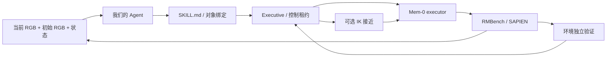

# Agent → Mem-0 → RMBench

本实验将项目现有 `Agent + StructuredPlanner + Executive` 接到 RMBench 的
`cover_blocks`。使用发布的任务专用 Mem-0 executor，**不是 π0.5，也不是官方 Planner**。

## 职责与目录

| 层 | 实现 | 职责 |
|---|---|---|
| 高层规划 | 现有 `agent/`、`providers/` | Codex gpt-5.5 medium 根据图像、事实和候选技能选下一步 |
| 技能契约 | `skills/rmbench/{cover,uncover}/SKILL.md` | 参数、前后条件、资源、超时和模型提示词 |
| 中间层 | 现有 `execution/` + `backends/rmbench.py` | 授权、调用、撤销、效果验证和控制权交接 |
| VLA | `vla/mem0.py` | 官方视觉编码、MemoryBank、结束分类器、flow-matching 动作头和归一化 |
| 仿真 | `simulation/rmbench_worker.py` | 持续存在的 SAPIEN 世界，执行 Aloha 14 维关节目标 |
| 实验入口 | 本目录 `run.py` | 配对种子评测及日志，不绕过现有 Agent |
| 大文件 | 忽略目录 `workspace/mem0/` | 上游源码、依赖、权重、资产、视频和运行日志 |



任务规格固定为六个有先后约束的目标，本实验不评测自然语言任务解析。
Agent 每次执行后重新规划；初始 RGB 作为显式视觉记忆保留，颜色与位置绑定由
Agent 读图决定。环境内部的未来目标状态序列只写入评测日志，不提供给规划器。
物理状态机提供当前事实，因此这也不是纯视觉成功验证实验。

## 两种控制模式

- `vla`：从当前姿态开始，接近、抓取、放置都由 Mem-0 预测动作。
- `ik_approach`：Agent 选定盖子后，CuRobo IK/运动规划执行官方抓取程序的**第一条
  pre-grasp move**，不执行其抓取、夹爪或放置步骤，再交给同一个 Mem-0 模型。

IK 使用仿真中的真实物体位姿，是带特权信息的对照。两种模式均不瞬移、不重置
子任务世界、不调用完整专家轨迹。IK 接近可能使输入偏离 executor 的训练分布，
其效果不能预设优于 VLA。IK 的轨迹耗时单独记录；`control_steps` 仅计 VLA 外层
动作，不包含 IK 内部物理步，不能直接作为两种模式总运动成本的公平比较。

执行器的结束分类器保留。分类器结束不等于技能成功，Executive 还会检查物理
后置条件。预测返回后再次检查控制租约，已撤销的动作不会下发；已下发的批次
最多执行 8 个动作后处理停止。本适配器用于仿真，不是实时真机控制接口。

## 来源与实验边界

- [RMBench 官方源码](https://github.com/RoboTwin-Platform/RMBench)，固定 commit
  `e43d39ff102ccc4c800c24e0ec54e51c94673822`。
- [Mem-0 发布权重](https://huggingface.co/qiuly/Mem-0-mn-RMBench)，固定 revision
  `b08bad88132ec7a232b707ed784cc6c14f0e7c33`。
- 使用 `cover_blocks/final_step30000.pt` 和其对应 `norm_stats.json`，下载后校验
  发布的 SHA256，严格匹配全部模型键。checkpoint 含训练优化器，磁盘约 15.3 GB。
- 官方 model card 的 76% / 100 episodes 是发布结果，**不是本地结果**。官方采用
  专家可解性筛选种子；本实验直接使用指定种子，标注为 smoke test。
- 本机 RTX 5090 使用 Torch 2.9 / CUDA 12.8 / Transformers 4.57.1 / SDPA；
  `patch_upstream.py` 从 Qwen 配置构建模型，再由完整 checkpoint 加载参数，避免
  重复加载基础权重。动作头输入显式转成其参数 dtype，修复 BF16→FP32 不匹配。
  这些兼容性改动意味着不是官方环境的逐位复现。

## 运行

当前机器的路径在 `config.json` 中。仿真与模型依赖隔离在
`workspace/mem0/.venv`，主项目依赖不安装大型仿真或模型包。

```bash
.venv/bin/python benchmarks/mem0/run.py \
  --output workspace/mem0/evaluation \
  --seeds 100000 100001 --modes vla ik_approach
```

输出目录必须是新目录，防止覆盖旧结果。每轮会留下：

- `summary.json`：真实环境成功、阶段、奖励、步数、模型/Agent 调用数及错误。
- `events.jsonl`：Agent 请求与结构化响应、技能决策、验证和控制生命周期。
- `physics.jsonl`：实际执行的模型动作、结束分类器、IK 目标与前后姿态。
- `media/rollout.mp4`、初始图像与逐步图像。
- `worker.log`：仿真、模型和底层库错误。

仅将 `physical_success=true` 计为成功。启动错误、超时和效果未达成都保留，不能
删除失败种子后重新计算。少量配对测试不能估计 benchmark 稳定成功率。

### 重建本机依赖

依赖已有可运行 SAPIEN/CuRobo 的 RoboTwin Python 环境。以下不会修改原环境：

```bash
/home/estar/miniconda3/envs/robotwin/bin/python -m venv --system-site-packages workspace/mem0/.venv
workspace/mem0/.venv/bin/pip install transformers==4.57.1 omegaconf qwen-vl-utils diffusers timm numpy==1.26.4
workspace/mem0/.venv/bin/python benchmarks/mem0/prepare_assets.py \
  --robotwin-assets /home/estar/czx/RoboTwin/assets
```

资产脚本下载本任务盖子和 Aloha；共享的背景、通用物体目录链接到现有 RoboTwin
资产。换机器需要提供真实存在的资产路径，并准备 CuRobo、mplib、SAPIEN 等原环境
依赖。本机完整环境包版本保存在 `workspace/mem0/environment-packages.txt`。

网页查看（只读，不触发机器人动作）：

```bash
.venv/bin/python -m http.server 8085 --bind 127.0.0.1 --directory workspace/mem0
```

打开对应运行目录，例如 `http://127.0.0.1:8085/smoke-01/`。
