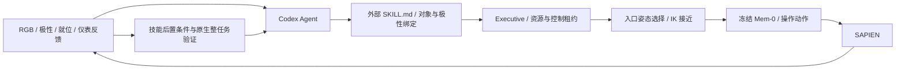

# battery_try：Agent、入口选择与 VLA 闭环评测

## 结果与验收口径

**已达到目标：20 个预先固定的独立测试回合中，13 个完整成功，样本成功率 65%。**
Wilson 95% 区间为 **43.3%–81.9%**。7 个失败全部计入：3 个操作未完成、4 个图像读取超时。

目标与种子在开发前固定于
[metric_contract.json](metric_contract.json)；不以开发集达标代替独立测试。

| 版本 / 数据划分 | 种子 | 原生整任务成功 | 用途 |
|---|---|---|---|
| v0，开发诊断 | 100000–100001 | 1/2 | 定位安装后的 IK 入口失败 |
| v1，完整开发集 | 100000–100007 | 7/8（87.5%） | 包含 1 次渲染基础设施失败 |
| v1，冻结独立测试 | 200000–200019 | **13/20（65%）** | 完整批次已通过 ≥10/20 的样本目标 |

v0/v1 的开发数据不合并；重复使用开发种子用于调试，不视为新增独立证据。
测试版本为 `7f25d45`，执行代码对应 `1968008`，冻结后未根据测试反馈调整策略。
全部种子直接初始化，无专家可解性筛选。失败、超时和启动错误均保留在分母中。

每回合只初始化一次世界，最多 1000 个原生 VLA 动作、12 次技能调用，任务执行时限 3600 秒。
初始化不占任务执行预算，但计入报告总耗时。
IK 接近由另一个控制接口执行，不消耗原生 VLA 步数，单独记录调度次数（初始双臂接近计一次）；这不是等物理步数的控制器比较。
原生 `env.eval_success` 为唯一整任务判据，还要求成功报告具有新鲜最终观测。
`stage=3` 只是界面诊断进度，不能替代原生成功标志。该上游任务的 `max_reward` 可在成功时仍为 0，因此不以 reward 数值判定成功。

### 独立测试逐回合记录

| 种子 | 结果 | VLA 步数（末次确认） | IK 调度 | Agent 调用 | 总耗时 / 秒 |
|---|---|---:|---:|---:|---:|
| 200000 | 失败：操作未完成 | 679 | 2 | 2 | 239.5 |
| 200001 | 成功 | 322 | 2 | 2 | 185.2 |
| 200002 | 成功 | 631 | 4 | 4 | 256.3 |
| 200003 | 成功 | 466 | 3 | 3 | 218.1 |
| 200004 | 失败：读取超时 | 135† | 1 | 1 | 331.6 |
| 200005 | 失败：操作未完成 | 918 | 3 | 3 | 319.6 |
| 200006 | 失败：读取超时 | 45† | 1 | 1 | 310.9 |
| 200007 | 成功 | 310 | 2 | 2 | 195.1 |
| 200008 | 成功 | 484 | 3 | 3 | 223.6 |
| 200009 | 成功 | 554 | 3 | 3 | 235.9 |
| 200010 | 成功 | 505 | 3 | 3 | 225.9 |
| 200011 | 成功 | 898 | 3 | 3 | 287.3 |
| 200012 | 成功 | 628 | 4 | 4 | 237.5 |
| 200013 | 成功 | 490 | 3 | 3 | 216.1 |
| 200014 | 失败：读取超时 | 45† | 1 | 1 | 308.3 |
| 200015 | 失败：读取超时 | 626† | 3 | 3 | 429.2 |
| 200016 | 成功 | 671 | 4 | 4 | 276.2 |
| 200017 | 失败：操作未完成 | 944 | 3 | 3 | 282.5 |
| 200018 | 成功 | 631 | 4 | 4 | 242.9 |
| 200019 | 成功 | 314 | 2 | 2 | 167.7 |

† 基础设施失败只列最后确认的步数，不能当作阻塞前的精确总动作数。

## 实际接入的权重

- [官方 Mem-0 checkpoint 仓库](https://huggingface.co/qiuly/Mem-0-mn-RMBench)，固定 revision
  `b08bad88132ec7a232b707ed784cc6c14f0e7c33`。
- 已下载约 15.3 GB 的 `checkpoints/battery_try/final_step30000.pt`，以及该任务的归一化统计。
- SHA256 校验通过：`c95daec4ff93c6def461364cf8868f69f9f9a4c8d66851ce15f35883f2529dad`。
- 模型使用 `strict=True` 加载，运行事件保存 `global_step=30000`、`weights_loaded_strict=true`。
- 使用 Qwen3-VL 视觉语言骨干、官方 MemoryBank、动作头和结束分类器。没有加载官方高层 Planner，也没有训练或修改 executor 权重。
- [RMBench 源码](https://github.com/RoboTwin-Platform/RMBench)固定
  `e43d39ff102ccc4c800c24e0ec54e51c94673822`；机器人为 Aloha 双臂，仿真器为 SAPIEN。

这是任务专用 Mem-0 executor 的评测，不是 π0.5 base。依赖与上游兼容补丁沿用
[Mem-0 部署说明](../README.md)。RT 渲染、无去噪、CUDA 图像读取、线性 patch projection
在开发和测试中一致；后者保留权重，但存在浮点舍入差异，因此不声称逐位复现官方实现。

## 为什么需要中间层

v0 的 seed 100001 在 235 个 VLA 动作后完成初始安装，但后续四次翻转请求都在
`grasp_actor → choose_grasp_pose` 返回空姿态时失败，尚未进入 VLA。
动作回放复现了这个失败：电池绕自身轴线转动后，物体坐标系中的标注抓取点也随之转动。
左臂在多个接近距离上均无法生成可达姿态，右臂仅部分距离可达。

新增的 [入口姿态选择器](../../../src/primitive_vla/simulation/approach.py)
将“任务应该操作哪个对象”和“当前姿态能否接入操作策略”分开：

1. Agent 根据观测和历史选择电池、目标极性。
2. 优先尝试官方接触标注对应的 0.10 m 接近姿态。
3. 不可达时依次尝试配置中的 0.08、0.12、0.06 m 接近距离。
4. 仍不可达时，以实测物体位置构造世界坐标系的上方接近姿态；方向与工具偏置来自配置。
5. 从当前机器人关节状态检查可达性，找到有效入口后仅执行接近动作。
6. VLA 负责抓取、夹爪、抬起、翻转、插入及释放；后置条件由观测独立验证。

每个候选的来源、距离、可达性写入 `physics.jsonl / approach_selection`。
开发集有 5 个回合实际启用了上方姿态回退，均完成整任务；这说明模块确实被使用，
但小规模开发结果不能单独证明因果增益。



## 哪些由 Agent、规则和 VLA 决定

| 内容 | 来源与边界 |
|---|---|
| 下一次翻转哪一节、翻成什么极性 | Codex gpt-5.5 medium 根据当前反馈与执行历史，从合法候选中选择 |
| 搜索原则 | 外部 [planner.md](planner.md) 提示一次改变一节、避免重复已失败组合；不是学习出来的新搜索算法 |
| 技能参数、前后条件和 VLA 指令 | [INSTALL_PAIR](../../../src/primitive_vla/skills/rmbench/battery/install_pair/SKILL.md) 与 [ORIENT_BATTERY](../../../src/primitive_vla/skills/rmbench/battery/orient/SKILL.md) |
| 接近方式 | 显式几何规则和 CuRobo 可达性检查；候选距离、工具偏置、方向均在 [config.json](config.json) |
| 抓取、旋转、插入轨迹 | 官方 VLA 基于图像、指令、状态和视觉记忆预测的 14 维关节/夹爪动作 |
| 何时认为技能结束 | 官方结束分类器 + 契约效果验证；分类器结束不等于任务成功 |
| 实际极性与是否就位 | 仿真器测得的物体状态，属于特权反馈，不是纯 RGB 估计 |
| 正确极性答案 | 仅由环境内部评测器使用，不提供给 Agent、VLA 或入口选择器 |

本版 `agent_supervision=false`：使用任务级闭环 Agent，不另加技能内部的模型恢复审阅。
独立测试实际有 54 次 Agent 规划调用、54 次 IK 调度，技能内部审阅调用为 0。
8 个测试回合使用了备选入口，共 9 次；成功回合的 VLA 动作数中位数为 505。
每个技能开始前建立 IK 前的视觉 anchor，接近后再更新当前图像，避免把接近后画面误作初始状态。
所有技能均通过现有 Agent/Executive；没有调用官方 `play_once`、脚本抓放或对象瞬移。

开发成功例 seed 100000 的 Agent 实际选择为：安装正正 → 观察仪表未开启 →
左侧改负（负正）→ 仍未开启 → 右侧改负（负负）→ 仍未开启 → 左侧改正（正负）→
原生成功。其他回合根据反馈提早结束。完整结构化决策与简短依据保留在事件日志中，不包含内部思维链。

## 已知失败与结论边界

- 开发 seed 100005 在第 539 个动作附近卡于 SAPIEN CUDA 图像读取；最后确认的观测为 535 步。
  请求超过 180 秒后终止该 worker 及其所属规划进程，未重跑或替换。该回合按失败计分，
  堆栈与 `cleanup.json` 记录了清理操作，界面和指标不能把缓存观测当作新鲜最终状态。
- 独立测试中的操作失败已包括：seed 200000 未能完成左侧翻转；200005 改变了极性但未重新就位；
  200017 在左侧翻转后右侧离槽，后续右侧操作达到技能步数上限。当前 ORIENT_BATTERY
  要求目标极性尚未满足，因此“极性已经正确、只需重新插入”的同极性修复没有合法候选。
  这是当前契约的已知限制，测试期间没有临时放宽它来修补特定失败种子。
- 测试 seeds 200004、200006、200014、200015 的图像读取阻塞均保留为失败，
  请求过期后清理对应进程；没有以排除这些回合后的比例作为最终成功率。
- 原生电池就位判据主要是 XY 距离，极性来自四元数近似分类；它不等价于真机电接触、插入力或释放成功证明。
- 仿真真值位置和状态被明确使用；本结果不证明纯视觉感知或真机部署能力。
- 未完成“移除 Agent / 固定脚本 / 无入口回退”的独立消融，不能把全部成功率归因于 Agent 创新。
  这里验证的是可配置中间层与冻结 VLA 组成的完整系统。
- 20 回合报告样本成功率和 Wilson 95% 区间；达到 50% 样本目标不代表已证明总体成功率下界为 50%。

## 运行、网页与证据

```bash
.venv/bin/python benchmarks/mem0/run.py \
  --config benchmarks/mem0/battery/config.json \
  --output workspace/mem0/battery/new-test --tier test \
  --seeds $(seq 200000 200019) --modes ik_approach --workers 2
.venv/bin/python benchmarks/mem0/battery/summarize.py workspace/mem0/battery/new-test
```

复跑以上测试种子是复现实验，不再是新的未见种子验收；进一步调参后必须使用新的预先固定测试块。

- [独立测试网页](http://127.0.0.1:8085/battery/test-v1/)
- [开发集网页](http://127.0.0.1:8085/battery/dev-v1/)
- [原始失败版本网页](http://127.0.0.1:8085/battery/dev-v0/)
- 本机证据目录：`workspace/mem0/battery/{dev-v0,dev-v1,test-v1}/`。
  `manifest.json` 保存配置、命令、种子、Git revision/status；每回合的 `events.jsonl` 保存 Agent/Executive 事件，
  `physics.jsonl` 保存入口候选和真实 VLA 动作，`summary.json` 保存最终判定，`media/` 保存帧和录像。

代码验证：51 项自动测试中 48 项通过、3 项跳过；真实模型和物理成功的证据来自上述评测，
不把模拟接口测试当作真实机器人验证。
