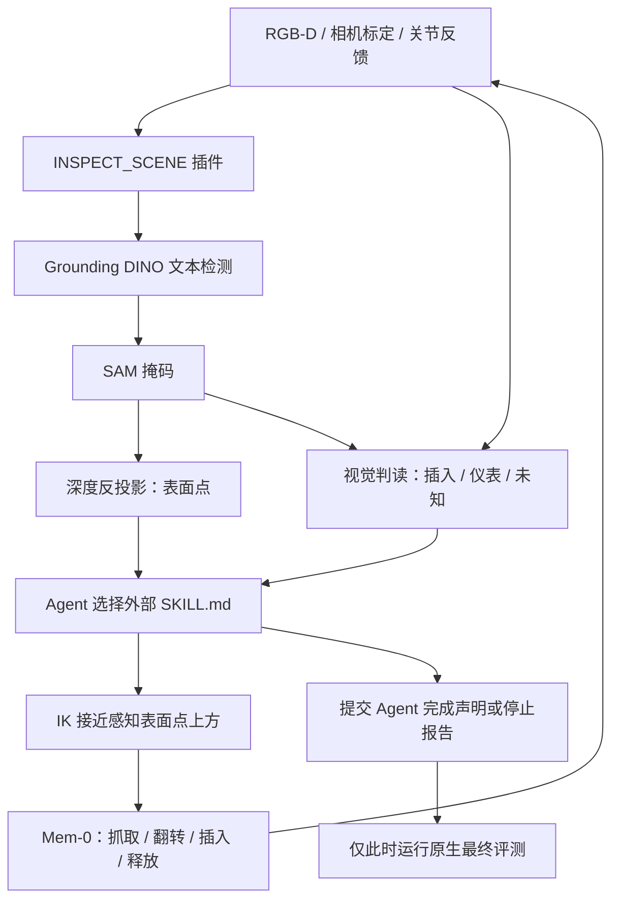

# RGB-D 感知插件评测：battery_try

本协议与 `battery/test-v1` 的真值辅助协议不同，不能把两者直接当作 Agent 增益消融。
本次使用官方 Grounding DINO tiny、SAM ViT-B、battery_try Mem-0 executor，
规划/视觉判读使用本机 Codex CLI 的 gpt-5.5 medium。没有加载官方 Mem-0 Planner。

## 模块与职责



- **Agent**：选择感知、安装、翻转、完成声明；读取历史避免盲目重复。
- **DINO**：根据配置的文本查询产生框和分数，可能误检或漏检。
- **SAM**：依据 DINO 的框预测掩码；高掩码分数不能证明物体身份正确。
- **RGB-D 几何**：以相机内外参反投影有效掩码像素，取世界坐标中位数。
  这是可见表面位置，不是刚体中心、资产接触点或经过验证的抓取位姿。
- **视觉判读**：Codex 从带编号的检测中选择两节独立电池，排除整体框和非目标。
  它接收当前 RGB、初始 RGB、分割覆盖图和检测框放大图，评估配置中的视觉条件，
  输出 true/false/unknown、置信度、可见证据。DINO/SAM 本身不判断极性或任务完成。
- **IK**：使用感知表面点、配置的工具偏移/净空/姿态做接近；可达性来自机器人运动学。
  不使用模拟器 actor pose、接触点或专家轨迹，找不到目标时不回退到真值。
- **Mem-0**：继续使用官方权重，接收 RGB、关节状态、子任务文字和内部时序记忆。
  输出 14 维双臂动作。掩码用于 Agent 判断和 IK 定位，没有直接加入 Mem-0 网络输入，
  也没有微调 Mem-0。单臂文字指令不构成另一只手完全静止的保证。
- **结束分类器**：只表示 VLA 交还控制权；动作预算也可触发交还。
  每次动作使旧感知失效，下一个动作必须经过重新检查。

### 允许的数据与隔离

用户明确允许 RGB-D、标定、关节反馈。图像和理想深度由仿真相机生成；相机标定对应
真机标定。当前未加入深度噪声、遮挡补全或真实相机畸变。

控制接口不返回物体真值位姿、极性、是否就位、奖励、stage、fail_flag 或 success。
动作次数/剩余动作预算是控制协议状态，不是任务物理状态。
`command:installation_attempted` 只记录发送过命令，不能用于证明安装成功。

原生 `take_action()` 会检查 `check_success()` 并自动锁存成功、停止动作。
传感器模式覆盖了这个行为，防止“成功就不再运动”泄露答案。
环境仍按自己的规则更新可见仪表，这是被拍摄的环境反馈；隐藏组合只留在环境内部，
没有传到 Agent/IK/VLA。它是仿真规则驱动仪表，并非真实电路仿真。

Agent 返回后，runner **先保存 `agent-report.json`，再调用一次原生最终评测**。
此后 worker 拒绝新的感知/控制请求。最终分数是终态判定，不是历史成功锁存值；
评测结果不能用于回合内重试。`agent_declared_complete` 与 `physical_success` 分列，
基础设施失败导致无法评测时后者为 null，而不是捏造失败或成功的物理事实。

### 固定规则与模型输出

| 内容 | 来源 |
|---|---|
| 技能名称、前置条件、VLA 子任务模板 | 外部 `SKILL.md`，人工设计 |
| 搜索不同极性、操作后重新检查 | 外部 planner.md 提示策略 |
| 检测文本、阈值、净空、工具四元数、预算 | config.json，可配置 |
| 目标检测框、分割掩码 | 下载的 DINO/SAM 实际推理 |
| 三维点 | 模型掩码 + 当前深度 + 标定的几何计算 |
| 独立目标筛选 | 视觉模型从 DINO 检测 ID 中选择，排除整体框 |
| left/right 绑定 | 视觉筛选后的两个有效目标按世界 x 排序；固定关联算法 |
| 下一技能、是否重试、是否宣告完成 | Agent 模型输出，受技能合同约束 |
| 可见就位/仪表判断 | 视觉模型输出，可能不确定或错误 |
| 抓取/翻转/插入/夹爪动作 | 官方 Mem-0 executor 推理 |
| 最终物理成功 | 回合结束后模拟器评测；不反馈给 Agent |

目前定位要求视觉筛选后恰好两个有效电池分割；遮挡、合并分割、误检或目标交叉会破坏绑定。
不会因为程序请求了某种极性，就向状态表写入该极性。现阶段视觉条件没有包含
难以从低分辨率图像可靠读出的电池正负极，搜索主要依赖命令历史与可见仪表反馈。

## 目录

```text
src/primitive_vla/plugins/grounded_sam/
  SKILL.md       # Agent 实际可选择的感知能力合同
  backend.py     # 复用 Executive / JsonProcess，发布估计事实
  model.py       # DINO → SAM → RGB-D 投影
  worker.py      # 可选模型依赖所在进程
  download.py    # 固定 revision 下载、记录 SHA-256
src/primitive_vla/backends/rmbench_visual.py   # 传感器模式的 VLA 交接
src/primitive_vla/simulation/rmbench_sensors.py # 传感器/终态评测接口
src/primitive_vla/skills/rmbench/battery_visual/ # 安装、翻转、完成声明合同
benchmarks/mem0/battery_visual/                # 配置、提示、网页、报告
workspace/perception/                         # 忽略入库的模型与开发工件
workspace/mem0/battery-visual/                 # 原始日志、RGB-D、掩码、视频
```

基础模型推理可复用；目前的执行适配器和双目标绑定针对 battery_try，尚未接入其他任务或 ROS。

DINO 与 SAM 组成一个有独立 `SKILL.md` 的可执行感知插件，而非伪造为两次必须由 Agent
分别调度的操作。模型推理留在 Python，能力说明和调度合同在 Markdown；不要求模型从
Markdown 执行任意代码。运行时可由配置移除该插件、更换模型路径、查询和阈值。

## 模型来源

| 模型 | 官方仓库 | 固定 revision | 本地权重 SHA-256 |
|---|---|---|---|
| DINO tiny | IDEA-Research/grounding-dino-tiny | a2bb814dd30d776dcf7e30523b00659f4f141c71 | 1a2412ef99bd74bcd3c2a246fa1e48581f8889a1300c9051974741314fc042f3 |
| SAM ViT-B | facebook/sam-vit-base | 70c1a07f894ebb5b307fd9eaaee97b9dfc16068f | 892c410e496344e527255ccdcb2cb7244a609acb5389c7c4fdba1288f861c579 |

实现使用本机 Transformers 4.57.1；接口参考官方
[Grounding DINO 文档](https://huggingface.co/docs/transformers/v4.57.1/model_doc/grounding-dino) 与
[SAM 文档](https://huggingface.co/docs/transformers/v4.57.1/model_doc/sam)。
Mem-0 权重、RMBench 源码固定版本沿用 [原基线记录](../battery/RESULTS.md)。

## 复现

在仓库根目录运行；沿用已准备好的 RMBench/Mem-0 环境及官方任务资产。

```bash
PYTHONPATH=src workspace/mem0/.venv/bin/python \
  -m primitive_vla.plugins.grounded_sam.download \
  --config benchmarks/mem0/battery_visual/config.json

PYTHONPATH=src .venv/bin/python benchmarks/mem0/run.py \
  --config benchmarks/mem0/battery_visual/config.json \
  --output workspace/mem0/battery-visual/new-run \
  --seeds 300100 300101 --modes ik_approach --workers 1
```

感知插件的 `device` 当前为 `cpu`、线程数 4：运行期间 GPU 有另一个任务占用约 17.5 GB，
GPU 版联合运行 OOM。官方感知权重没有替换为假实现；Mem-0 与 SAPIEN 仍在 GPU。
GPU 空闲时可配置 `device=cuda`，不需要改 Agent 或技能合同。

网页通过 `python3 -m http.server 8085 --bind 127.0.0.1 --directory workspace/mem0` 提供。
每个输出目录有 `index.html`，可查看视频、最新掩码、Agent 决策和原始证据。


## 本轮实际结果（2026-09-17）

**固定测试种子 300100、300101：最终物理成功 0/2；Agent 完成声明 0/2；错误完成声明 0 次。**
这是两个样例的 smoke test，不是可靠成功率估计，也不能沿用旧真值辅助协议的 65%。

| 种子 | Agent / 原生终态评测 | 规划调用 | 感知调用 | IK 调度 | VLA 批次 / 动作 | 耗时 |
|---|---|---:|---:|---:|---:|---:|
| 300100 | 停止 / 失败 | 6 | 3 | 2 | 45 / 672 | 425.5 s |
| 300101 | 停止 / 失败 | 12 | 6 | 5 | 60 / 861 | 682.8 s |

测试期间固定了控制代码、技能、提示和配置。网页展示样式另行改善，不影响控制。
`manifest.json` 记录配置、种子、Git 状态与源文件哈希；`audit.json` 记录汇总和数据隔离核对。

### 一条完整日志：300101

以下是 Agent 实际选择的顺序，不是预先写好的执行脚本：

1. `INSPECT_SCENE`：DINO/SAM 定位桌面电池，视觉模块选择独立目标。
2. `INSTALL_PAIR_VISUAL`：根据 RGB-D 点做 IK 接近，VLA 执行 229 步。
3. 检查显示两节电池看似就位、仪表未激活；筛选 ID，排除包含两节电池的整体框。
4. Agent 依次请求左正、左负、右正、右负，每次都重新检查；VLA 分别执行 156、162、163、151 步。
5. 最新视觉检查仍认为仪表未激活。Agent 认为各单侧方向均已尝试，选择停止。
6. 保存 `agent-report.json` 后，原生最终评测返回 `success=false`。

**推理缺陷**：把各电池的正负方向各试一次，不能覆盖所有双电池方向组合。
按命令假设，这条轨迹经过的是 `(正,正) → (正,正) → (负,正) → (负,正) → (负,负)`，
并没有请求过 `(正,负)`。这些只是请求历史，不代表真实极性；本轮从未读取真实极性。
Agent 缺少清晰的“组合假设—已发命令—视觉结果”记忆，因此浪费动作且提前停止。

300100 则在重复左正命令后耗尽 450 步技能预算，画面显示一节电池在槽外，机械臂遮挡另一节；
视觉模块无法给出可靠的双目标绑定，Agent 停止。没有用真值位置绕过遮挡。

### 开发过程与未掩盖的失败

- `dev-v0 / 300000`：GPU 感知与另一个约 17.5 GB 的 GPU 任务竞争显存，OOM；
  由操作者中止，最终评测不可用。不计入后续固定测试两例，原始日志保留。
- `dev-v1 / 300000`：改为 CPU 感知后运行完整回合，最终失败。15 批 / 225 个 VLA 动作；
  插入后出现两个独立框加一个整体框，原先的“检测总数必须为 2”绑定规则拒绝后续动作。
  开发期间更新了停止提示，结束无效的静止画面重复检查，此轮不是冻结测试。
- `test-v2`：增加视觉模型对检测 ID 的筛选、局部放大图及操作后感知失效机制；
  两个新种子均实际完成评测，无基础设施中断，但任务未成功。

### 已验证与尚未解决

已验证：官方感知权重实际推理、Agent 选择外部技能、RGB-D 驱动 IK、Mem-0 执行动作、
操作后重新观察、拒绝未知目标、终态评测与控制隔离。9 次感知、7 次 IK 调度、
105 批 / 1533 个 VLA 动作均有原始记录。自动测试 57 项：54 通过、3 跳过；
wheel 中包含插件与嵌套技能文件。

尚未解决：组合级搜索记忆、遮挡后的主动观察/恢复、从表面点估计合适的工具姿态、
VLA 无进展时的提前交接、视觉判读的误差校准。本轮不能证明任务成功、鲁棒物体指向、
真机可部署性或 Agent 的独立因果增益。

### 查看工件

- [测试网页](http://127.0.0.1:8085/battery-visual/test-v2/)
- [汇总与隔离核对](http://127.0.0.1:8085/battery-visual/test-v2/audit.json)
- [300101 结构化日志](http://127.0.0.1:8085/battery-visual/test-v2/ik_approach-300101/events.jsonl)
- [300101 Agent 终止报告（评测前）](http://127.0.0.1:8085/battery-visual/test-v2/ik_approach-300101/agent-report.json)
- [300101 最终结果](http://127.0.0.1:8085/battery-visual/test-v2/ik_approach-300101/summary.json)

## 无新增技能的自适应版本

入口配置为 [adaptive.json](adaptive.json)，沿用同样四个 `SKILL.md`、同样的 DINO/SAM/Mem-0
权重和传感器边界。本次增加的是通用的信息与执行接口，不写电池方向的固定尝试顺序。

1. **实际指令可见**：规划上下文包含技能的 VLA 指令模板、候选的实际指令；执行历史记录
   已下发的 `policy_prompt`。模型可以知道某次双臂命令究竟请求了什么。
2. **模型维护工作记忆**：每次规划返回 `working_memory`，包括当前假设、带证据的联合配置
   尝试和不确定性。Python 只保存并传回模型生成的记录，不枚举方向组合、不替模型选下一步。
   工作记忆不会写入 `State.facts`；完成声明仍受新鲜视觉条件约束。
3. **执行中视觉复查**：每约 160 个未结束的 VLA 动作，模型比较当前、入口和前次复查 RGB，
   选择继续或交回 Agent。交回后使用原有 INSPECT_SCENE 重新评估。正常的模型结束分类器
   和总动作预算仍然有效；复查不是每帧实时监控。
4. **独立目标绑定**：视觉模型可以只绑定一个可靠可见目标，隐藏目标保持未知。
   这样原有单侧 ORIENT_VISUAL 仍可能合法；是否利用它推进任务或恢复可见性由规划模型决定。
   没有从历史位置补出当前坐标，也没有增加退让、移动相机或释放夹爪技能。

通用规划提示在 [adaptive_planner.md](adaptive_planner.md)，执行复查提示在
[adaptive_handoff.md](adaptive_handoff.md)。这里的自适应发生在推理、记忆和调用调度层，
不是在线训练 VLA，也不代表模型能实现固定动作集合之外的新物理能力。

```bash
PYTHONPATH=src .venv/bin/python benchmarks/mem0/run.py \
  --config benchmarks/mem0/battery_visual/adaptive.json \
  --output workspace/mem0/battery-visual/adaptive-replay \
  --seeds 300100 300101 --modes ik_approach --workers 1
```

这是两个已知失败种子的复测，不是未见种子泛化评测。多项接口改善一起启用，
不能据此单独归因于工作记忆、执行监督或部分目标绑定中的某一项。

### 自适应复测结果

四个原有 `SKILL.md` 的 SHA256 均未改变；两批运行使用的运行时代码、提示和配置哈希一致。
模型权重未训练或更换。两例都由 Agent 先根据新鲜图像声明完成，再由独立终态评测确认。

| 种子 | 上一版结果 / VLA 动作 | 自适应版结果 / VLA 动作 | Agent 调用 | IK 调度 |
| --- | --- | --- | --- | --- |
| 300100 | 失败 / 672 | 成功 / 535（基础设施中断后原配置补跑） | 8 | 3 |
| 300101 | 失败 / 861 | 成功 / 537 | 11 | 3 |

**完整评测 2/2 成功，错误完成声明 0 次；另有 1 次基础设施中断，最终结果未知。**
300100 首次尝试在已确认 150 个动作后卡住，worker 打印到第 157 步；诊断栈停在
CUDA 相机读回。操作者终止了本次卡死的 worker，停止未获确认，控制保持锁定，
最终评测不可用。原日志保留，未计作算法成功，也不是 Agent 自主修复了基础设施。
随后使用相同冻结配置对该种子补跑一次。

实际的高层运动选择如下，中间均穿插视觉检查：

- **300100**：双正安装 → 左负 → 右正 → 图像完成声明。模型发现双正未激活后自主选择
  改变左侧；左负后读表为 unknown，又做了一次右正，仍有冗余确认操作。最终耗时 534.75 秒。
- **300101**：双正安装 → 左正 → 右负 → 图像完成声明。仍重复了一次左正，但随后选择
  上一版遗漏的联合命令配置。另有 3 次普通 observe 没有运行感知插件，模型之后自行改选
  INSPECT_SCENE；该接口区别仍需改善。最终耗时 575.29 秒。

这些是**下发指令的记录，不是真实极性标签**。运行时未读取真实极性；最终原生评测仅提供
终态布尔结果。Agent 能重新组合已有能力，实际抓取和翻转动作仍来自 Mem-0。

两次完整回合各进行一次执行中视觉复查，均选择 continue；本次没有实际触发 yield。
全部检查都绑定了两个目标，因此**不能声称已实证提前中断恢复或单目标遮挡恢复**。
相关接口有自动测试，但实际恢复效果还需专门实验。两个旧失败案例成功也不能证明
未见场景的成功率；本轮没有单因素消融，无法独立归因于某一个模块。

测试共 60 项：57 通过、3 跳过。日志核对未发现禁止的任务真值字段，全部 IK 目标来自
DINO + SAM + RGB-D；所有 Agent 终止报告均不包含终态评测结果。哈希与逐次运行统计见
[复测审计](http://127.0.0.1:8085/battery-visual/adaptive-replay/audit.json)。

[打开回放、模型工作记忆与复查记录](http://127.0.0.1:8085/battery-visual/adaptive-replay/)
（包含中断尝试及补跑）。
