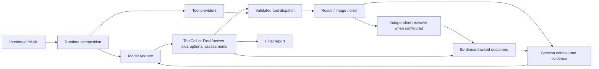

# Model-directed tool Agent

The canonical loop is `agent/core.py:Agent`. It accepts free-text instructions and depends on a model, tool runtime, session, event log and optional finish check. It does not enumerate symbolic candidates, parse goals into facts, choose a robot, or impose a perception/motion/policy pipeline.

## Public interfaces

- `Model.step(ModelContext, tuple[ToolDefinition, ...])` returns `ModelReply`.
- `ModelReply` contains either calls or a `FinalAnswer`; optional memory updates the working summary, and optional assessments record action judgments in the same response.
- `Tool.call(arguments, CallContext)` returns `ToolResult`. Arguments are validated against the tool's JSON Schema.
- Action tools declare resources and implement `stop(call_id, reason) -> bool`.
- Plugin constructors take exactly `(options, PluginContext)`. Providers expose `tools`; optional start/close methods own their connections.
- `FinishCheck.check(answer, ModelContext)` returns a rejection reason or None.
- `OutcomeReviewer.assess(OutcomeContext)` returns a goal, satisfied/unsatisfied/unknown verdict, reason and evidence references. It receives execution evidence, not the planner's working-memory conclusions or executable tools.

`agent/contracts.py`, `tools/contracts.py` and `verification/contracts.py` define these contracts. There is no separate symbolic scene or robot domain model in the core.

Concrete local robot and model integrations live in independent Python packages under `extensions/local/`. New local extensions are ignored by Git; this repository explicitly tracks Cobotmagic and existing tabletop example files, while generated data and model weights remain ignored. Install a package and configure its factory through the existing adapter interface; no directory scanning or core imports are required. Each extension owns its dependencies, scene configuration, worker, documentation and tests. See [local extensions](../extensions/README.md).

For the current real-robot deployment, see [Cobotmagic control flow and migration contracts](cobotmagic-control-flow.md): sequence diagrams distinguish the generic Agent, robot extension, shared perception code and external controllers.

## Context and evidence

Session stores an append-only history and complete results. The model receives a bounded recent view, instructions, working memory, remaining budgets, and available image references. Oversized events are explicitly marked as previews. Built-in `session.search` and `session.read` retrieve earlier events and paginate large results. Model Adapters materialize images in the transport's supported format.

The JSONModel Adapter supports existing HTTP JSON-chat and Codex CLI transports. It passes tool schemas and descriptions in the prompt and decodes structured calls. This is JSON-mediated tool use, not a claim of native function-calling support for every provider. A custom Model Adapter can retain its provider-specific continuation state in its task-owned instance.

## Execution lifecycle

Tools are dispatched sequentially by the Agent. The tool runtime also rejects resource conflicts between concurrent external callers. Identical call IDs share an execution; conflicting reuse is rejected. This deduplication is in-session, not a cross-restart exactly-once guarantee.

The runtime validates finite JSON arguments, optional output schemas and deadlines. Errors and rejected calls are fed back to the model. It never automatically retries a physical action.

Cancellation revokes CallContext before requesting stop. Tool authors must check context immediately before local dispatch and enforce call-ID fencing in remote controllers. Stop is acknowledged only after the controller is no longer active. Unconfirmed stopping locks further action tools. TaskService persists that lock; a journaled action interrupted by process restart also locks control.

All in-process plugins are trusted executable code. A plugin that ignores cancellation can require process isolation; the runtime cannot forcibly stop arbitrary Python code or hardware. There is no automatic control-unlock endpoint.

## Completion

A tool's `ok` status means the invocation completed, not that the physical task succeeded. The model decides when to observe or evaluate, and returns completed/blocked/failed with reasons and evidence call IDs. Invented call references are rejected. An optional finish check can reject the final answer and send feedback into the loop. Without that check, the status is the model's conclusion, not an independent ground-truth evaluation.

Verification defaults to `main_agent`: the main model assesses before/after evidence in its normal next response, optionally returning assessments alongside calls or a final answer. No extra model request or verification turn is required. `Session.outcomes` records judgments, sources and revisions; it never gates dispatch or completion. Only structure and evidence references are validated.

Explicit `independent` mode adds a reviewer request after actions with `review_outcome=True`. It receives task/action evidence, without planner memory, full history or executable tools. A world model can implement the same interface. Independent mode also exposes optional `session.assess` for reassessment. The main model retains control over subsequent decisions in both modes; review failures never replay actions. Outcomes persist across turns as historical evidence. Contracts, recording, image context and independent review live together in `verification/`. See [verification contracts](verification.md).

## Core boundary

| Directory | Responsibility |
| --- | --- |
| `agent/` | Model decisions, tool loop, working memory and public model contracts |
| `tools/` | Tool contracts, dispatch, cancellation, resources and generic HTTP tools |
| `runtime/` | Plugin composition, lifecycle, sessions and task service |
| `providers/` | HTTP and Codex model transports; no weight loading |
| `verification/` | Action evidence, recorded judgments and optional independent reviewer |
| `config/` | Generic YAML configuration and plugin options |
| `storage/` | Events and task/session persistence |
| `web/` | Generic Agent HTTP API and UI |

Concrete VLA protocols, robot kinematics, ROS, simulators, weights and scene instructions belong to extensions. The old `vla/`, `skills/`, `simulation/`, `domain/`, `execution/` and `backends/` trees, symbolic planner/parser and `SceneTools` migration layer have been removed. Generic tool lifecycle checks remain in `tools/runtime.py`.

The core starts without robot tools. Software examples live in [extensions/demo](../extensions/demo/README.md), and Qwen weight serving lives in [extensions/qwen_vlm](../extensions/qwen_vlm/README.md). Both are optional packages using explicit configuration. Instruction files remain plain UTF-8 text; loading them does not require a skill catalog.

The original design discussion is recorded in [extensibility-proposal.md](extensibility-proposal.md); [tools.md](tools.md) documents the implemented interfaces.
