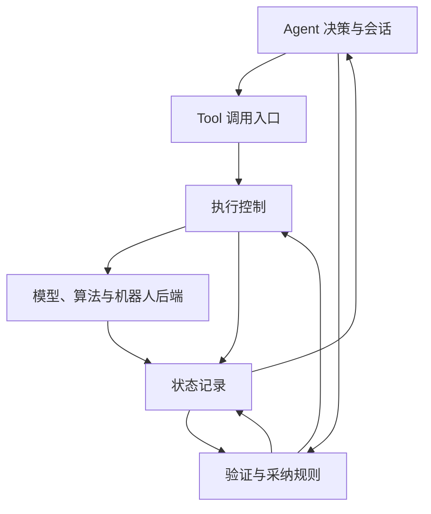

# 具身 Agent 架构

Agent 负责理解目标、选择能力和调整计划。状态记录、执行控制、验证共同支撑能力协作，
分别位于 `state/`、`execution/`、`verification/`。三者是模块职责，不要求独立服务或固定调用流水线。

模型内部决定尝试、观察和调整的顺序。运行循环提供工具反馈、预算和控制约束，不编排
电池安装等任务步骤，也不要求模型把每个假设写成 StateClaim。模型可直接读取原始观测，
在下一轮选择新的动作；这些接口是否可用与实际模型的推理能力分别验证。

## 状态记录

`StateJournal` 保存观测、工具结果、执行事实、环境判断和验证历史。`Session` 保留任务文本、
对话事件和工作摘要，通过兼容属性读取运行记录。模型改写 memory 不会改写控制器回执。

`Observation` 记录真实采集时间、传感器、可选 subject/frame、原始数据或工件引用；
metadata 保留 adapter 的扩展描述，data 保留领域数据。`StateClaim` 只提交对象、
版本化属性、值、依据和不确定性。来源、接收时间、记录 ID 和执行关联由运行代码添加。
对象引用的范围由能力声明：Cobotmagic detection token 是帧内引用，不代表跨帧跟踪。

共享 `media.Artifact` 用 kind、uri 描述图片、点云、深度等资源，可选元数据允许 null。
Observation、ToolResult、StateResult 使用同一格式；输入工具可复用类型生成 schema。
结构化 data 支持任意 JSON。状态区分 known、partial、unknown，属性契约决定值是否可为空；
严格验证不采纳 partial 及其派生依据。详见 [多模态与空值](multimodal-contracts.md)。

历史追加保存，当前视图按来源与观测时间计算。晚返回结果不覆盖较新的观测；不同来源冲突
同时保留。动作进入派发入口、新传感器帧、TTL 和会话恢复会使相关信息失效。
采集时间缺失或超前为 unknown，接收时间不冒充采集时间。单纯的进度值不是完成概率。
默认 lifetime=scene 的观测随动作失效；静态地图、标定可标为 reference，跨动作复用，
仍受自身 TTL、替代版本和历史恢复约束。同名 sensor 的新观测按 subject 区分。
旧地图与新定位共同产生的判断以实时测量计时，同时检查地图依赖；参考资料不能单独
证明当前物理目标完成。当前动作对动态状态的失效仍是全局的，尚未按设备划分。

模型得到受限的近期历史、原始观测索引、状态和判断摘要；`state.query/read` 与 `session.search/read` 提供
按需检索。完整记录放入带版本的 `state_records` 快照，并兼容读取旧会话快照。
任务结束快照写入 TaskStore；执行意图和结束事件在运行中写入日志。恢复不自动重放物理动作。

## 执行控制

`ExecutionManager` 负责工具参数校验、调用去重、前提检查、资源占用、期限和停止确认。
`tools.runtime.ToolRuntime` 保留为兼容导入。直接调用仍等待动作返回；声明 device_id 的
动作可经 execution.submit 异步提交到 ActionQueue，Agent 随即获得任务 ID 并继续决策。
同设备串行，不同设备无共享资源时并行；共享资源按提交顺序仲裁，直接调用不能越过队列。
队列在实际派发时仍执行参数、权限、期限与目标前提检查。FIFO 不表示前序动作成功，
需要解释反馈后才能决定的下一步应由模型等待结果再提交。

execution.query/wait/cancel 提供查询、按 revision 等待变化和取消。模型上下文携带
活动及近期任务的紧凑视图；实际动作结果进入原有状态与验证路径，提交回执不充当完成证据。
排队／运行任务尚未结束时拒绝 completed。其他结束、预算耗尽、超时或用户取消都会撤销
排队任务并停止活动动作，再生成报告或完成取消。队列随会话存活，不自动恢复执行或重放动作。

ExecutionTool 仍轮询 start/inspect 到终态，可以作为队列内的动作后端复用。
段内实时避障、平衡和伺服由后端处理，不能提前宣称控制释放来模拟异步运行。
全局控制锁和状态／严格验收范围尚未按设备隔离，联合任务及重启恢复执行仍见 [TODO](../TODO.md)。

三个状态分别表达：

| 信息 | 表达 |
| --- | --- |
| 调用结果 | ToolResult.status：ok/error/rejected/timed_out/cancelled |
| 物理执行 | ExecutionUpdate.phase：accepted/running/finished/stopped/unknown |
| 控制权 | ExecutionUpdate.control：held/released/unknown |
| 异步任务 | 排队、运行、取消中、结束或异常；task_id 与实际动作 call_id 相同 |

`ok`、`finished` 和目标满足不是同义词。新后端可用 start/inspect/stop，经 ExecutionTool
接入。现有 call/stop 工具保持兼容；仅有旧停止回执时记录 stopped，不推断任务完成。
显式 execution.control 优先于兼容字段 control_released。

控制未知时保留占用并锁定动作。取消已接收不算停止。TaskStore 保留重启后的 active_control
与 control_locked；解除需要机器人侧核对。进程内资源锁和工作区锁不等于跨进程机器人仲裁，
远端仍须拒绝已取消的调用 ID，防止迟到请求再次派发。

## 验证

验证按目标和证据生成判断，判断来源可以是主 Agent、独立模型或规则后端。
主 Agent 可在正常回复中同时提交 assessments、claims 与下一次调用，不增加验证轮次。
独立后端使用 assess(OutcomeContext)，不获得可执行工具。

`AssessmentResult.status` 区分 ok、unsupported、error；成功判断的 verdict 区分
satisfied、unsatisfied、unknown。旧 OutcomeAssessment 返回值仍支持。

默认判断仅供参考。配置了 `verification.policy` 时，执行入口检查动作前提，任务结束入口
检查完成条件。条件引用稳定 goal_id；代码检查证据时效、历史、预测依赖、来源冲突与可选
对象参数绑定。严格验收还需已确认执行结束后的证据；后端可用 ended_at 提供实际结束时间。配置不要求固定任务顺序。
契约检查不证明视觉或模型判断本身准确，仍需真实任务评估。

## 能力接入

| Interface | Adapter 责任 |
| --- | --- |
| Model.step(context, tools) | 产生调用或最终回答，可附判断 |
| StateBackend.estimate(request, context) | 在声明的属性范围内返回判断、资源或结构化数据 |
| OutcomeReviewer.assess(context) | 针对给定目标与证据生成验证结果 |
| Tool.call / stop | 兼容现有同步工具与动作停止 |
| ExecutionBackend.start / inspect / stop | 管理可查询的长动作生命周期 |

`state/backends.py` 定义估计请求、返回值和后端接口；`state/estimation.py` 按配置绑定
状态后端，并检查目标、契约和证据范围。默认仅在 unsupported 时
执行显式配置的回退；error 回退需另行声明。每次尝试保留来源。动作不使用这种自动回退机制。

外部模型结果可以直接由 adapter 转换并采纳，也可以由主 Agent 读取后再提交推断，引用原始
结果或判断记录。adapter 不补造缺失语义。Skill 继续提供流程知识，不授予控制权。

## 目录与兼容性

| 目录 | 责任 |
| --- | --- |
| agent/ | 决策循环、会话和工作摘要 |
| state/ | 状态契约、后端估计、记录、失效和查询 |
| execution/ | 设备队列、异步任务工具、执行生命周期、资源和停止 |
| verification/ | 验证目标、判断、采纳条件 |
| tools/ | Tool 契约、函数和 HTTP adapter、兼容导入 |
| runtime/ | 插件装配、资源生命周期、任务与会话续接 |
| providers/ | HTTP/Codex 模型传输 |
| storage/ | SQLite 任务、快照、事件和控制锁 |
| config/、web/ | 配置及查看入口 |

具体 IK、ROS、VLA、权重、标定和机器人语义仍属于扩展。核心可以不安装扩展启动。
配置继续使用 schema_version: 2；新增字段有默认值。旧 data/images、call/stop、reviewer
和 finish_check 仍可用。重新出现的 execution/ 是通用执行管理，不恢复旧符号规划器。

接入示例见 [工具接口](tools.md)、[配置](configuration.md)、[结果验证](verification.md)。
逐提交说明见 [重构记录](changes/README.md)。

## 目录职责审查（2026-10-26）

审查口径是同一模块是否围绕同一类变化、是否越过接口承担其他模块的工作，不以文件数
或函数数判断。覆盖核心全部源码目录、共享文件、web/static，以及 Cobotmagic 扩展各
子目录的职责与依赖。第三方环境、模型权重和 workspace 运行资料不作为项目源码审查。

| 核心模块 | 单一职责及接口 | 结论 |
| --- | --- | --- |
| agent/ | 模型决策、工具反馈循环和有限的会话上下文 | 职责成立；编排状态、执行、验证不等于实现这些模块的算法。core/model/memory 各自承接循环、模型协议和上下文 |
| state/ | 状态证据及其估计、记录与查询 | 已修正：估计后端从 capabilities 归入；journal 不加载模型、不执行动作，也不依赖验证模块 |
| execution/ | 对动作拥有控制权：派发、队列、资源和停止 | 职责成立；queue 管顺序，runtime 管实际控制，tool/tools 是两种接口适配，不负责选择任务计划 |
| verification/ | 生成目标判断并决定证据是否可被采纳 | 已修正：无判断语义的图片函数移至 media；policy 不向机器人派发动作 |
| tools/ | 工具调用／返回契约、函数与 HTTP 适配 | 职责成立；tools/runtime.py 仅保留旧导入别名，执行实现在 execution，不维护第二套执行器 |
| providers/ | 模型传输、编码、错误与连接生命周期 | 有待收敛：codex_schema.py 手写 Agent／验证字段，传输适配同时拥有业务返回结构，详见下文 |
| config/ | 配置结构、校验与文件读写 | 职责成立；可引用 verification 的配置契约，不加载插件或启动模型／机器人 |
| runtime/ | 装配应用及拥有任务／插件生命周期 | 职责成立；session 装配，service 管工作区任务，process 管 worker，composition 解析工厂；不产生任务计划 |
| storage/ | 持久化任务、事件、控制未确认记录和恢复标记 | 职责成立；保存控制事实不等于控制机器人，不判断物理目标，也不重放动作 |
| web/、web/static/ | HTTP 与浏览器界面适配 | 职责成立；图片上传、连接测试与配置路由属于界面操作；任务控制委托 TaskService，没有第二个 Agent 循环 |
| contracts.py、media.py | 共享消息约束、资源引用与图片上下文 | 职责成立；不含任务判断、模型调用或机器人控制 |
| cli.py、__main__.py、__init__.py | 命令行装配入口与包元数据 | 职责成立；任务执行复用 TaskService，不另写任务运行逻辑 |

### 尚未消除的语义耦合

`providers/codex_schema.py` 为严格输出协议手写 tool_step 和 outcome_assessment 的字段，
`agent/model.py`、`verification/contracts.py` 又分别定义业务响应结构。即使没有反向
Python import，新增业务字段仍需同步修改传输模块，不能据静态依赖测试宣称完全遵循
单一职责。后续应由业务调用方提供唯一响应契约，provider 只负责严格协议编码／解码。
这涉及模型 wire 格式兼容，本轮记录为独立重构项，没有顺带更改已验证的模型协议。

### 扩展目录的检查

| Cobotmagic 目录 | 结论 |
| --- | --- |
| 根目录及 static/ | 相机桥与图像工具入口、独立展示页面；hover.py、ik_web.py 为兼容入口；不应让核心反向依赖 |
| perception/ | 负责观测推理，client/worker/models 隔离环境、进程协议和模型实现；未承担动作控制 |
| vla/ | 负责具体策略执行与 worker 生命周期，重依赖留在 worker 后端；不归入通用 state |
| agent/ 及 static/ | 负责此机器人接入应用；provider 组合工具，motion/reset/recovery 实现硬件行为。目录名不表示第二套通用 Agent 决策循环 |
| calibration/ 及 static/ | 负责标定工作流；职责聚合成立，但 core.py 同时承接样本采集／保存和数值求解，存在文件级拆分机会 |
| ik/ 及 static/ | 负责像素到运动工作流；kinematics 的数值职责清晰，execution.py 混合 TCP 桥、路径生成、交互确认和执行，需另行拆分 |

本轮不修改真实机器人协议和数值求解流程。扩展中上述文件级问题已列入 TODO，不能把
“核心目录职责清晰”扩大成“所有扩展文件均满足单一职责”。

依赖规则由 tests/integration/test_module_boundaries.py 回归约束：状态与执行不反向依赖
Agent、模型传输或应用装配，storage 不依赖领域实现，生产核心不静态导入机器人／测试
实现。契约引用、装配模块及旧 tools.runtime 别名是明确允许的关系；静态规则不代替上述
对文件行为、动态插件和语义重复的人工检查。
