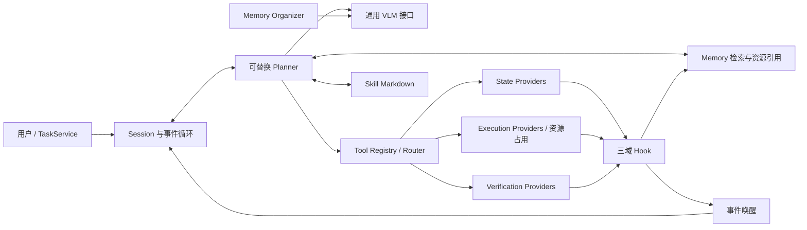

# 架构与设计决策

## 决策与能力

State、Execution、Verification 是工具域。它们不各自拥有一个模型，也不构成固定执行管线。
一次决策只选择一个下一步操作；异步调用返回后，Planner 可继续调用其他工具或等待事件。
相机流和其他 State 数据可以独立推送。任务依赖、准备条件、失败后的恢复动作由 Planner 决定。

核心运行循环不依赖具体机器人或模型。ModelPlanner 使用统一规划提示词，VLM 实现只处理模型通信。
唯一固定的决策集合是框架操作，例如发现工具、
读取记忆、调用工具、等待事件、向用户提问；其参数中的工具名称和业务内容完全由扩展决定。

## 模块

| 目录 | 职责 |
| --- | --- |
| `planning/` | Planner 协议、共享提示词、通用 ModelPlanner、上下文预算与组装 |
| `vlm/` | 独立模型配置、生成接口、文本/图像/函数契约、DeepSeek / GPT 通信实现 |
| `runtime/` | Agent 事件循环、Session、预算、生命周期 |
| `runtime/connections/` | 平台进程启动与关闭、通用本地通信、远程 Tool 与视角连接 |
| `tools/assembly.py` | 平台进程内部读取环境、组合包和 Skill，检查声明依赖 |
| `tools/registry/` | ToolSpec 注册、Schema 编译、能力发现 |
| `tools/router.py` | Provider 调用边界、执行句柄、超时/停止协议 |
| `tools/hooks.py` | 统一持久记录、三域扩展 Hook、事件发布 |
| `tools/state/` | 持续观测入口与唤醒策略 |
| `tools/execution/` | 机器人控制资源拓扑、原子占用、冲突证据 |
| `tools/verification/` | Verification 公共契约 |
| `workspace/robocasa/` | 外置平台实现、启动配置、场景与 Skill |
| `skills/` | Markdown 索引与分页读取 |
| `memory/` | Markdown 工作记忆、原始 JSON 日志、资源引用、TTL 与定时整理 |
| `events/` | 版本化唤醒信号与订阅 |
| `interfaces/` | 可嵌入终端、服务或地图界面的任务 API |

`tools/assembly.py` 只读取配置与 Skill，不启动进程，也不依赖 Runtime。
平台入口调用 `tools/assembly.py`；宿主 `runtime/connections` 不读取平台文件，只接收报告的工具与 Skill 文本。
`application.py` 分别加载模型配置与启动配置，将已连接的平台与 VLM、Planner、Agent 组合。
平台路径不依赖 workspace 目录约定，运行数据路径由启动配置指定。

## 入口校验与错误边界

- 注册时验证 Tool 描述及 JSON Schema，编译输入/输出校验器。
- Planner 的下一步输出在决策入口验证一次；Tool 参数在路由入口验证一次。
- Provider 返回值在 Provider 边界验证一次。内部传递已验证的对象，不逐层重复判空。
- `try/except` 集中在模型、Provider、Hook 和异步等待边界。模型/工具错误进入 Memory 供下一轮决策使用。
- 参数错误只反馈具体原因、路径和失败输入，不展开整个 Schema。模型返回错误函数名或多个调用时，
  记录收到的调用和预期格式，交给下一轮纠正；不执行、改名或挑选其中一个调用。
- `before_call` Hook 可以拒绝执行；其余 Hook 的异常单独记录，不能改写已经发生的执行事实。
- 存储等内部故障向宿主传播，暂停 Planning，不伪装成可由模型修复的业务失败。

没有将参考图像相似度、抓取步骤、物体状态字段或恢复顺序写入 Runtime。

## 控制占用与停止

资源由应用按机器人实例定义。一个别名展开为一组叶子资源，例如 `whole_body` 可以映射至
某个本体实际拥有的资源。框架不预设 `whole_body` 的组成；别名不递归嵌套。

一次占用先检查全部叶子资源，再原子写入所有权。冲突返回资源名称和占用它的 `call_id`。
未声明的资源被拒绝，不允许用名称拼写差异绕过资源检查。不同机器人实例的资源彼此独立。

异步接口的返回只代表请求已受理。控制资源保持占用直至：

1. Provider 的 `execute` 返回，确认底层操作确实已经结束；或
2. Provider 的 `cancel` 返回严格的 `True`，确认底层已停止。

超时、Python 协程取消、通信异常、请求停止都不等于物理停止。未确认停止的调用保持
`stop_unconfirmed`，其资源仍被占用。正常返回发生在请求停止之后时，也能结束该占用；
因超时/异常发起停止的调用保留原失败原因。

`pause` 只暂停 Planning；`cancel` 请求停止 Session 的全部调用。若有调用不能确认停止，
Session 保持 `stopping`，`pending_status` 记录目标终态。宿主调用 `reconcile` 重试确认，
之后可进入 `cancelled` 或 `budget_exhausted`。停止确认的等待时间不计作成功完成动作。

资源管理范围为**一个进程、一个 asyncio 事件循环**。同一个机器人只能由一个 Runtime 拥有；
跨进程 Provider 可以通过适配层接入，但不提供跨进程/跨主机分布式资源锁。

## 事实、判断与任务报告

ToolResult 的 payload 遵循其自身输出 Schema。Execution 的 `completed` 只表示操作结束。
Verification 使用独立的 `subject / conclusion / reason / evidence / related_call_id` 契约，
包括无法判断的 `uncertain`。验证失败仍可能是一次正常完成的 Tool 调用。

Memory 不推断或提升事实。Planning 写下的计划/假设保留 `planning` 来源；它不能通过
框架动作改写 Tool 的原始证据。`finish` 是 Planning 的任务报告，可引用验证记录；
框架不会把报告自动转换为 Verification 结论。如何判定具体目标完成由 Planner 和对应 Skill 决定。
仍有活动控制或未确认调用时，不允许结束任务。

## Memory 与上下文

公共记录包含 UUID、UTC Unix 时间戳、Session/Task/Call 关联、来源、工具域、事件、状态、payload
和资源引用。长短期工作记忆保存为 Markdown，Session 保存为 JSON；运行路径不使用数据库。
原始事件独立保存在只追加的 JSON journal 中。`lifetime` 表示生命周期，不能替代证据可信度。

资源保存为 `ResourceRef`；内置 blob 存储按 SHA-256 寻址，原始字节不进入 JSON 记录。
外部 URI 只登记元数据，可展示图像由 Provider 解析后存入 blob。内部 `Memory.get_resource` 返回引用，
`Memory.read_resource` 读取本地 blob 字节；二者不是模型动作。Runtime 不自动访问网络或任意文件 URI。

`search` 支持条件过滤、分页以及逐词 AND 的字面子串检索，包括中文；当前不含 embedding 模型。
长期记录可以跨 Session 检索。应用可替换检索实现。更新操作保留记录身份和来源。

模型请求从原始 journal 投影为有序对话。会话目标和用户补充保留为用户消息，实际提问和任务报告保留为助手消息。
每个已派发的决定附有对应的结果，同步返回的图片直接放在结果中。异步完成和持续观测作为独立 Runtime 更新，
按事件顺序加入，不挂在 wait 的结果上。工具、Skill 摘要和相关 Memory 作为单独的补充上下文。
PlanningContext.data 仍可供自定义 Planner 使用，内置 ModelPlanner 发送 PlanningContext.messages，不重复发送旧的状态快照。

每轮按字符预算取舍历史，优先保留目标、最新用户补充和近期图片，按完整的调用与结果一起裁剪。
活动调用和可用工具目录先于普通历史分配预算，避免任务进行到一半时可用能力从模型上下文中消失。
大结果提供预览和原始记录引用，可通过 evidence_get 读取。预算包含动作 Schema，图片张数由独立上限控制，
字符数不是模型的精确 token 计数。原始 journal 保留完整证据，不使用额外模型来生成历史摘要。
read_skill / inspect_tool 的最近 8 页定义可作为补充上下文，避免读取图像后丢失参数说明。

各工具域 Hook 自动保留本地图像，默认最多 2 张，按资源 ID 去重。挂载图片使用稳定短引用、相机名称或描述、
以及已知尺寸；像素由 ModelPlanner 按内部资源引用读取。超额淘汰图片不会重绑旧引用。
evidence_get 可重新附上原始记录中的历史图像。图像记录后若有执行活动，附带 execution_since_image；
没有这个提示不能证明画面仍实时有效。后台预览仍不等于正式任务观测。

模型依据用户要求与工具用途决定是否补充观测，不由 Runtime 强制固定动作顺序。
图片短引用在 Session 内稳定，附件重排、淘汰或 Session 重载不会改变其指向。
Tool 顶层字符串参数用 `format: image-ref` 声明需要图片引用，Runtime 在分发前解析为资源 ID。
平台从资源私有 metadata 读取相机、场景和帧并验证是否适用；核心不包含 RoboCasa 的步号规则。
引用也可用于 ask_user 展示、evidence_get、Memory 来源及 finish 证据，持久证据关系保存原始记录 ID。
`inspect_tool` 同时返回该工具对应的 Skill 首页，帮助模型理解坐标方向、输入语义及使用条件。
读取的 Skill 按正文分页，参数 Schema 单独提供；用于装配的 YAML、entrypoint、超时和资源锁配置留在平台协议。
`SkillStore.documents()` 继续提供完整部署文档。

模型接口与审计契约分开：不默认暴露 Session/Task ID、计数器、TTL、时间戳和空错误字段。
工具结果压平为名称、调用引用、状态、业务输出与可选错误/验证；同步返回的结果与 journal 里的同一终态合并。
call_id 可用于状态查询、取消和验证关联，evidence_id 可用于引用原始证据；这些可操作引用仍保留。
通用框架不递归删除业务 payload 中的 id 或 timestamp；平台负责定义有用的结果字段。
参考 [OpenAI 的本地上下文与模型上下文区分](https://openai.github.io/openai-agents-python/context/)、
[smolagents 的步骤存储与消息投影](https://github.com/huggingface/smolagents/blob/main/src/smolagents/memory.py) 和
[Anthropic 的工具输出设计](https://www.anthropic.com/research/writing-tools-for-agents)。

观测默认 TTL 为 60 秒，进度记录 300 秒；执行结果、验证和错误默认保留。
过期记录立即从读取结果消失，`cleanup` 或 `maintain(stop_event)` 物理清理过期短期记录。
`memory_delete` 允许 Planner 删除当前 Session 的短期工作记忆，不删除 journal 或 blob，
因此不会改变实际调用状态或丢掉重启恢复依据。`finish` 的证据引用也读取原始 journal。

`MemoryOrganizer` 复用 VLM 接口，默认每 300 秒按预算整理新/变更的长期文档、笔记、验证和失败记录；
不把每帧观察发送给模型。来源 ID、版本与替换权限在发布前校验；并发修改会使旧提案失效。
引用的原文快照和被合并的旧笔记存入 archive，新笔记标明 model_summary，并重建 MEMORY.md。
没有变化时不重复调用模型。桌面 lifespan 管理后台任务，退出会取消正在进行的整理请求。
整理异常由状态接口显式呈现，不静默重试；具体格式、配置与限制见 [Memory 设计](memory.md)。

## 事件、预算与恢复

事件总线只保存每个 Session 的唤醒版本和信号，证据保存在 Memory。多次通知可以合并；
推理开始前记下版本，之后 `wait` 检查版本变化，避免推理期间到达的事件丢失。

普通流数据只入 Memory。显著变化或显式订阅的数据源唤醒 Planner；终态、错误和用户输入同样唤醒。
数据源自己定义什么是显著变化。订阅高频源时，Provider 应按业务需要采样或限速。

预算覆盖决策次数、Tool 请求次数（包括被拒绝的请求）、连续错误次数、活动时间和单轮模型超时。
暂停和等待用户不消耗活动时间；等待工具或周期事件会消耗。预算跨恢复保留。

进程重启时，在接收新任务前扫描没有终态的 `tool_started` 记录，恢复其资源占用并隔离为
`stop_unconfirmed`。Provider 必须支持用持久的 `call_id` 识别底层作业并幂等确认停止。
重新加载 Session 后处于暂停或原先的等待用户/停止状态；不存在自动重放运动命令的路径。
旧 Provider 或机器人拓扑缺失时启动报错，应先恢复扩展配置并处理未结束的物理任务。
