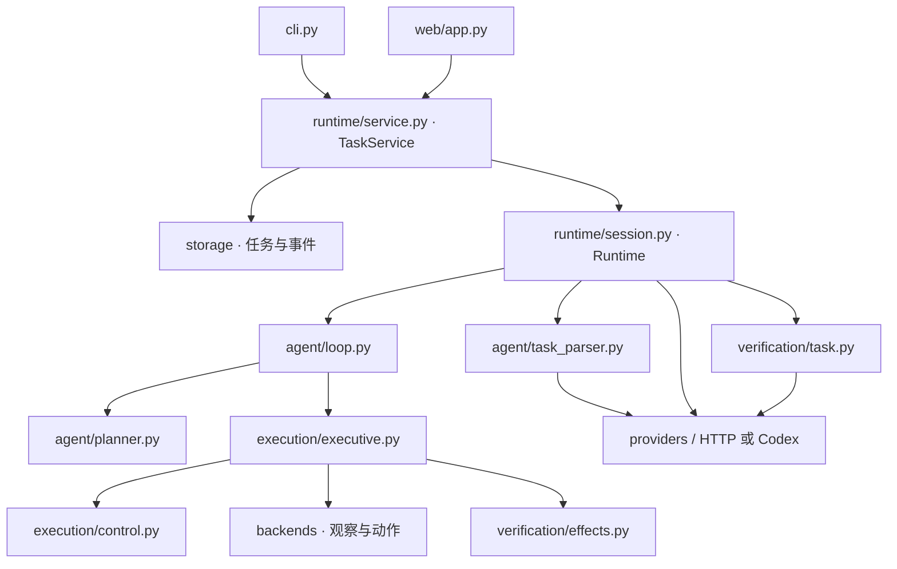

# 架构与目录约定

项目按“任务理解 → 技能规划 → 执行 → 观测验收”组织代码。`runtime` 负责把这些组件组装为任务会话，CLI 与网页通过同一个任务服务访问它。

> 当前默认动作路径已更新为 MOVE_TO（IK）→ π0.5（关节动作块），详见 [VLA 控制](vla-control.md)。新增 `vla/` 负责模型进程与转换，`simulation/policy_control.py` 负责直接关节驱动；高层 provider 保持独立。

## 文件树

LIBERO Agent 路径与 SAPIEN 共享 `agent/`、`execution/` 和网页：新增 `backends/libero.py`、`simulation/libero_worker.py`、`vla/libero.py` / `libero_worker.py`、`runtime/process.py`；技能位于 `skills/libero/*/SKILL.md`，配置位于 `configs/libero-agent.json`。独立策略评测入口仍在 `benchmarks/libero/`，两者共用 `vla/libero.py`，源码不反向依赖 benchmark 脚本。见 [实际双目标闭环](libero-agent.md)。

```text
primitiveVLA/
├── src/primitive_vla/
│   ├── skills/
│   │   ├── loader.py          # Markdown 技能发现与加载
│   │   ├── kitchen/*/SKILL.md # 六类符号厨房技能
│   │   └── sapien/*/SKILL.md  # 三类仿真技能及动作程序
│   ├── domain/
│   │   ├── models.py          # Fact、Observation、Task、SkillCall、SkillResult
│   │   ├── state.py           # 观测合并、时效与状态快照
│   │   └── skills.py          # SkillSpec、参数绑定、候选技能与条件判断
│   ├── agent/
│   │   ├── task_parser.py     # 结构化任务、模板与 VLM 目标解析
│   │   ├── planner.py         # Planner 接口、A*、结构化模型规划器
│   │   └── loop.py            # 观察、单步规划、执行、重规划
│   ├── execution/
│   │   ├── control.py         # 控制租约、资源所有权与执行代次
│   │   └── executive.py       # 去重、启动、监控、停止与效果验收调度
│   ├── backends/
│   │   ├── base.py            # 观察和动作执行协议
│   │   ├── mock.py            # 独立符号世界与可配置故障
│   │   ├── http.py            # 机器人 HTTP 网关适配器
│   │   └── sapien.py          # RoboTwin 环境中的仿真进程适配
│   ├── simulation/
│   │   ├── worker.py          # JSON Lines 协议、仿真时钟与控制请求
│   │   ├── scene.py           # 物理场景、观测证据、相机与录像
│   │   └── motion.py          # 通用运动算子与文件化程序解释器
│   ├── providers/
│   │   ├── vlm.py             # 多模态请求、图像与模型响应处理
│   │   ├── base.py            # 统一 JSON 决策协议
│   │   ├── factory.py         # 按配置选择 provider
│   │   ├── codex.py           # CLI 多模态调用与取消
│   │   ├── codex_schema.py    # 严格输出结构与条件格式转换
│   │   └── local_server.py    # 独立环境中的本地 Qwen 模型服务
│   ├── verification/
│   │   ├── effects.py         # 基于新鲜观测的技能效果验收
│   │   └── task.py            # rules / audit / enforce 任务验收
│   ├── runtime/
│   │   ├── session.py         # 按配置组装并运行一个任务
│   │   └── service.py         # 工作区锁、任务启动/取消、生命周期与查询
│   ├── config/
│   │   ├── schema.py          # 统一配置模型与配置边界校验
│   │   ├── loader.py          # 默认配置、部分覆盖、完整快照与保存
│   │   └── defaults/
│   │       ├── kitchen.json   # 内置对象、事实与图像配置
│   │       └── tasks.json     # 可选规则任务模板
│   ├── storage/
│   │   ├── tasks.py           # SQLite 任务、事件与控制锁持久化
│   │   └── events.py          # 内存事件流、持久化 sink 与 JSONL 输出
│   ├── web/
│   │   ├── app.py             # FastAPI 应用、路由与静态资源挂载
│   │   ├── schemas.py         # HTTP 请求结构
│   │   └── static/            # index.html、app.js、style.css
│   ├── cli.py                 # 命令行参数与服务启动
│   ├── __main__.py            # python -m primitive_vla
│   └── __init__.py            # 包版本
├── configs/
│   ├── vlm.json               # 模型部署覆盖示例
│   └── sapien.json            # 单臂物理仿真完整配置
├── examples/
│   ├── pack_fruit.json        # 结构化装盒任务
│   └── collect_and_stir.json  # 多物体入碗、搅拌与归位
├── docs/                      # 架构、配置、接入协议与参考来源
├── tests/integration/
│   ├── test_agent.py          # 执行与控制边界
│   ├── test_console.py        # 网页、存储、HTTP 后端与 VLM 调用链
│   └── test_simulation.py     # 按需运行的物理仿真取消测试
├── workspace/                 # config.json、数据库、media/、runs/ 与锁
├── README.md
└── pyproject.toml
```

代码包各有 `__init__.py`，树中省略重复展示。`defaults/` 与 `static/` 是安装包资源目录；`.venv/`、`*.egg-info`、`__pycache__/` 是本地环境或工具生成物，不是业务模块。

## 调用与依赖



图表示主要调用关系。共享配置与领域类型省略；依赖遵循以下约定：

- `domain` 只使用标准库，不导入运行时、模型客户端或网页框架。
- `config` 定义配置并引用领域类型；`storage` 只管理持久化与事件，不启动任务。
- `backends` 实现观察和动作协议；控制租约属于 `execution/control.py`，避免由某个后端掌握全局权限。
- `verification` 根据证据输出结论，不直接修改观测状态或派发动作。
- `skills/loader.py` 从 Markdown 加载技能；`agent` 解析目标、选择技能并运行闭环；`providers` 处理模型通信。
- `runtime` 负责组件选择、任务预算、工作区与任务生命周期，不导入 FastAPI、`web` 或 `cli`。
- `web` 负责 HTTP 输入输出与网页资源；任务冲突由 `TaskService` 抛出 `TaskConflict`，网页将它映射为 HTTP 409。

## 扩展代码放在哪里

| 需要扩展 | 修改位置 |
|---|---|
| 调整模型地址、提示词、超时、技能条件或场景 | 部署配置或网页配置；字段说明见 [configuration.md](configuration.md) |
| 新增一种技能契约，已有后端能执行 | 在技能源目录新增 `<名称>/SKILL.md`，已有算子可组合为新技能，无需新增 Python 分支 |
| 新增 VLA、RL、ROS 或仿真动作后端 | `backends/<name>.py` 实现 `Backend`，在 `config/schema.py` 声明配置类型，在 `runtime/session.py` 注册组装 |
| 新增规划算法 | `agent/planner.py`；规模增长后拆为同包内独立模块，在 `runtime/session.py` 选择 |
| 接入不同格式的模型服务 | `providers/`；解析、规划和验收仍通过各自职责调用 |
| 增加感知证据或验收方式 | 观测转换放后端；技能验收放 `verification/effects.py`，任务结论放 `verification/task.py` |
| 增加 API 或网页展示 | HTTP 放 `web/app.py`、载荷放 `web/schemas.py`、界面放 `web/static/` |
| 接入另一个任务入口 | 复用 `runtime.service.TaskService` 的 `start`、`cancel`、`get_task`、`close`，无需依赖网页 |

模型通信使用 `ModelClient` 协议，`factory.py` 按配置创建 HTTP `VLMClient` 或 CLI `CodexClient`；`providers/local_server.py` 在独立环境托管本地 Qwen 权重。新后端类型需要代码注册，已有组件的选择和参数通过配置控制。

SAPIEN 是可选运行时：`backends/sapien.py` 通过独立 Python 进程调用 `simulation/`。网页环境不会导入 SAPIEN；场景与动作模块也不依赖 FastAPI。完整接入说明见 [simulation.md](simulation.md)。

## 配置、示例与运行数据

- **随包默认值**：`src/primitive_vla/config/defaults/`，安装后也能加载。
- **部署覆盖**：`configs/`，例如不同 VLM 服务的配置；启动时用 `--config` 选择。
- **任务输入**：`examples/`，用 `--task` 提交。
- **运行数据**：由 `--workspace` 指定，默认 `workspace/`。CLI 导出默认放 `<workspace>/runs/<时间>/`，可用 `--log-dir` 覆盖。

本次已将原根目录 `runs/` 的历史输出移入 `workspace/runs/`。现有工作区配置、任务数据库和图像保留；API 路由与启动命令保持一致。旧平铺模块的 Python 导入路径已替换为上述包路径，未保留重复实现或转发文件。

## 验证

```bash
.venv/bin/python -m unittest discover -s tests -v
.venv/bin/python -m primitive_vla serve
```

现有集成测试覆盖核心行为；目录重构还需确认构建出的 wheel 包含默认 JSON 和网页资源。无需为目录层级或简单转发额外添加重复测试。
