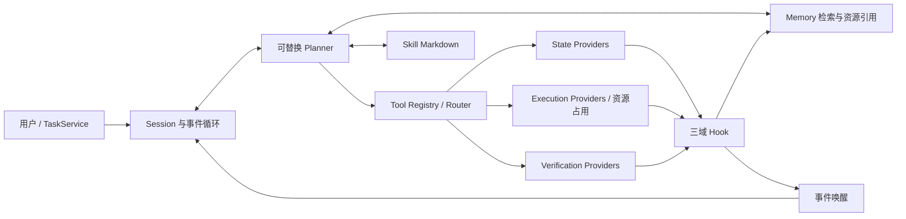

# 架构与设计决策

## 决策与能力

State、Execution、Verification 是工具域。它们不各自拥有一个模型，也不构成固定执行管线。
一次决策只选择一个下一步操作；异步调用返回后，Planner 可继续调用其他工具或等待事件。
相机流和其他 State 数据可以独立推送。任务依赖、准备条件、失败后的恢复动作由 Planner 决定。

生产包中没有具体机器人能力和模型适配器。唯一固定的决策集合是框架操作，例如发现工具、
读取记忆、调用工具、等待事件、向用户提问；其参数中的工具名称和业务内容完全由扩展决定。

## 模块

| 目录 | 职责 |
| --- | --- |
| `planning/` | Planner 协议、决策契约、上下文预算与组装 |
| `runtime/` | Agent 事件循环、Session、预算、生命周期 |
| `tools/registry/` | ToolSpec 注册、Schema 编译、能力发现 |
| `tools/router.py` | Provider 调用边界、执行句柄、超时/停止协议 |
| `tools/hooks.py` | 统一持久记录、三域扩展 Hook、事件发布 |
| `tools/state/` | 持续观测入口与唤醒策略 |
| `tools/execution/` | 机器人控制资源拓扑、原子占用、冲突证据 |
| `tools/verification/` | Verification 公共契约 |
| `providers/` | Provider 协议，无具体实现 |
| `skills/` | Markdown 索引与分页读取 |
| `memory/` | SQLite、资源索引、文件数据、TTL |
| `events/` | 版本化唤醒信号与订阅 |
| `interfaces/` | 可嵌入终端、服务或地图界面的任务 API |

## 入口校验与错误边界

- 注册时验证 Tool 描述及 JSON Schema，编译输入/输出校验器。
- Planner 的下一步输出在决策入口验证一次；Tool 参数在路由入口验证一次。
- Provider 返回值在 Provider 边界验证一次。内部传递已验证的对象，不逐层重复判空。
- `try/except` 集中在模型、Provider、Hook 和异步等待边界。模型/工具错误进入 Memory 供下一轮决策使用。
- `before_call` Hook 可以拒绝执行；其余 Hook 的异常单独记录，不能改写已经发生的执行事实。
- 存储等内部故障向宿主传播，暂停 Planning，不伪装成可由模型修复的业务失败。

没有将参考图像相似度、抓取步骤、物体状态字段或恢复顺序写入 Runtime。

## 控制占用与停止

资源由应用按机器人实例定义。一个别名展开为一组叶子资源，例如 `whole_body` 可以映射至
某个本体实际拥有的资源。框架不预设 `whole_body` 的组成；别名不递归嵌套。

一次占用先检查全部叶子资源，再原子写入所有权。冲突返回资源名称和占用它的 `call_id`。
未声明的资源被拒绝，不允许用名称拼写差异绕过资源检查。不同机器人实例的资源彼此独立。

异步接口的返回只代表请求已受理。控制资源保持占用直至：

1. Provider 的 `execute` 返回，确认底层操作确实已经结束；或
2. Provider 的 `cancel` 返回严格的 `True`，确认底层已停止。

超时、Python 协程取消、通信异常、请求停止都不等于物理停止。未确认停止的调用保持
`stop_unconfirmed`，其资源仍被占用。正常返回发生在请求停止之后时，也能结束该占用；
因超时/异常发起停止的调用保留原失败原因。

`pause` 只暂停 Planning；`cancel` 请求停止 Session 的全部调用。若有调用不能确认停止，
Session 保持 `stopping`，`pending_status` 记录目标终态。宿主调用 `reconcile` 重试确认，
之后可进入 `cancelled` 或 `budget_exhausted`。停止确认的等待时间不计作成功完成动作。

资源管理范围为**一个进程、一个 asyncio 事件循环**。同一个机器人只能由一个 Runtime 拥有；
跨进程 Provider 可以通过适配层接入，但不提供跨进程/跨主机分布式资源锁。

## 事实、判断与任务报告

ToolResult 的 payload 遵循其自身输出 Schema。Execution 的 `completed` 只表示操作结束。
Verification 使用独立的 `subject / conclusion / reason / evidence / related_call_id` 契约，
包括无法判断的 `uncertain`。验证失败仍可能是一次正常完成的 Tool 调用。

Memory 不推断或提升事实。Planning 写下的计划/假设保留 `planning` 来源；它不能通过
框架动作改写 Tool 的原始证据。`finish` 是 Planning 的任务报告，可引用验证记录；
框架不会把报告自动转换为 Verification 结论。如何判定具体目标完成由 Planner 和对应 Skill 决定。
仍有活动控制或未确认调用时，不允许结束任务。

## Memory 与上下文

公共记录包含 UUID、UTC Unix 时间戳、Session/Task/Call 关联、来源、工具域、事件、状态、payload
和资源引用。SQLite 同时保存长短期记录和 Session。`lifetime` 表示生命周期，不能替代证据可信度。

资源保存为 `ResourceRef`；内置 blob 存储按 SHA-256 寻址，原始字节不进入 JSON 记录。
外部 URI 只登记元数据，由 Provider/模型适配器解析。`get_resource` 返回引用，
`read_resource` 读取本地 blob 字节；Runtime 不自动访问网络或任意文件 URI。

`search` 支持条件过滤、分页以及逐词 AND 的字面子串检索，包括中文；当前不含 embedding 模型。
长期记录可以跨 Session 检索。应用可替换检索实现。更新操作保留记录身份和来源。

默认上下文包含目标、Session 状态、上次结果、活动调用、能力摘要、Skill 摘要、最近记录及命中的
长期记录。大记录提供摘要片段、记录 ID 与分页入口。预算以 JSON 字符数计，包含框架动作 Schema；
不声称它是模型 tokenizer 的精确 token 计数。目标及必要协议本身超出预算时明确报错。
Planner 可通过 `memory_get`、`read_skill` 按页继续读取，避免整段历史持续膨胀。

观测默认 TTL 为 60 秒，进度记录 300 秒；执行结果、验证和错误默认保留。
过期记录立即从读取结果消失，`cleanup` 或 `maintain(stop_event)` 物理清理过期短期记录。
默认不删除 blob，也不自动将观察或推测总结成长期事实；长期整理可由外部管理器调用 Memory API 实现。

## 事件、预算与恢复

事件总线只保存每个 Session 的唤醒版本和信号，证据保存在 Memory。多次通知可以合并；
推理开始前记下版本，之后 `wait` 检查版本变化，避免推理期间到达的事件丢失。

普通流数据只入 Memory。显著变化或显式订阅的数据源唤醒 Planner；终态、错误和用户输入同样唤醒。
数据源自己定义什么是显著变化。订阅高频源时，Provider 应按业务需要采样或限速。

预算覆盖决策次数、Tool 请求次数（包括被拒绝的请求）、连续错误次数、活动时间和单轮模型超时。
暂停和等待用户不消耗活动时间；等待工具或周期事件会消耗。预算跨恢复保留。

进程重启时，在接收新任务前扫描没有终态的 `tool_started` 记录，恢复其资源占用并隔离为
`stop_unconfirmed`。Provider 必须支持用持久的 `call_id` 识别底层作业并幂等确认停止。
重新加载 Session 后处于暂停或原先的等待用户/停止状态；不存在自动重放运动命令的路径。
旧 Provider 或机器人拓扑缺失时启动报错，应先恢复扩展配置并处理未结束的物理任务。
