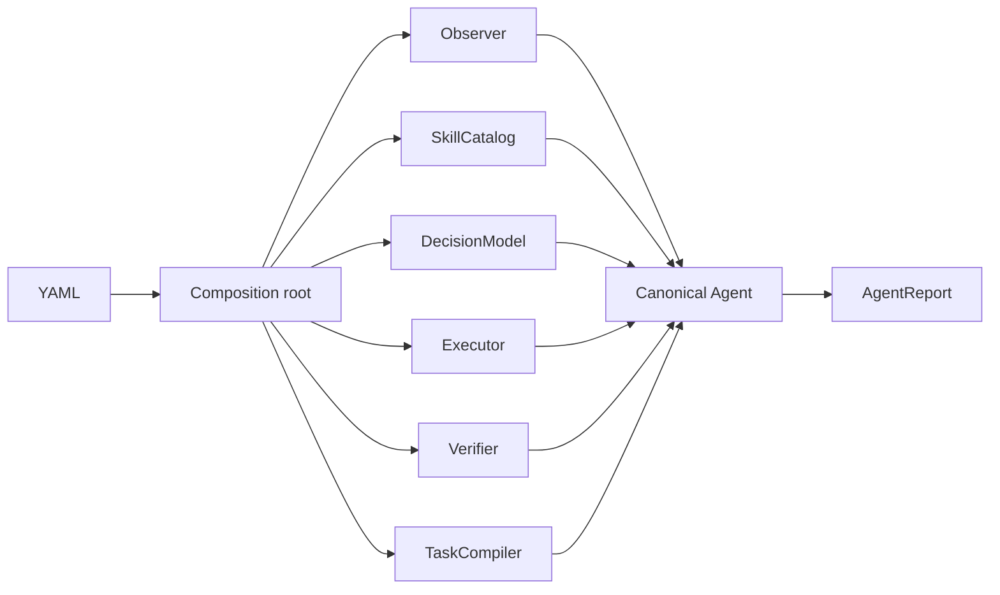

# Agent architecture

## Contracts

`primitive_vla.agent.contracts` defines the stable seams:

- `Observer.observe() -> Observation`
- `DecisionModel.decide(DecisionContext) -> Decision`
- `SkillCatalog.candidates/resolve`
- `Executor.execute/stop/close`
- `TaskCompiler.compile`
- `Verifier.verify`
- `Memory.read/update`
- `Agent.run(Task, AgentContext) -> AgentReport`

The Agent owns budgets, cancellation, retries, lifecycle events, decision history, and the final report. It does not parse task language, load skill files, call a VLM, control a scene, run a policy, or decide whether the physical task succeeded.

## Composition

`runtime.composition` imports paths from YAML and validates their required methods. `runtime.session.Runtime` constructs the scene adapter, skill catalog, compiler, decision model, executor, verifier, memory, and Agent, then passes the completed `AgentContext` to the loop.

## Execution seams

The Agent-facing executor hides scene and policy details. The Mock adapter interprets deterministic commands. The SAPIEN adapter composes a SAPIEN scene with a scripted execution declaration or an optional `PolicyPort`. The π0.5 implementation is a policy strategy; it is never selected by a scene-level type branch.

## Verification

Execution reports execution state only. `RuleVerifier` independently checks observed facts against skill effects and task goals and returns `success`, `failure`, or `unknown`.

`Executive` owns dispatch preconditions, invariant monitoring, controller leases,
deadlines, and acknowledged stopping. It accepts an `ExecutionBackend` for action
and a separate `Observer` for monitoring; the runtime injects its configured
observer. Direct callers may still use a combined backend as the default observer.
It does not perform a post-action observation or assess effects. The Agent owns
that observation and calls its configured `Verifier`.

For compatibility, execution results retain `effect`, `evidence`, and
`needs_observation`: Executive returns `unknown`, an empty dictionary, and `true`.
`changes` describes facts seen during execution monitoring, not verified effects.
The result's optional `started_at` wall-clock timestamp lets `RuleVerifier`
reject pre-action facts retained in State as evidence for the current skill.
Custom executors should supply it when available; omitted timestamps retain the
existing current-fact behavior. Independent verdicts appear in each Agent result's
`verification` and in `skill_verified` events, without rewriting execution status.
