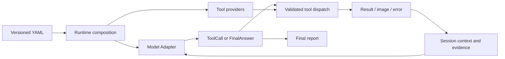

# Model-directed tool Agent

The canonical loop is `agent/core.py:Agent`. It accepts free-text instructions and depends on a model, tool runtime, session, event log and optional finish check. It does not enumerate symbolic candidates, parse goals into facts, choose a robot, or impose a perception/motion/policy pipeline.

## Public interfaces

- `Model.step(ModelContext, tuple[ToolDefinition, ...])` returns `ModelReply`.
- `ModelReply` contains either calls or a `FinalAnswer`; its optional memory field updates the working summary.
- `Tool.call(arguments, CallContext)` returns `ToolResult`. Arguments are validated against the tool's JSON Schema.
- Action tools declare resources and implement `stop(call_id, reason) -> bool`.
- Plugin constructors take exactly `(options, PluginContext)`. Providers expose `tools`; optional start/close methods own their connections.
- `FinishCheck.check(answer, ModelContext)` returns a rejection reason or None.

`agent/contracts.py` and `tools/contracts.py` are the public contracts. `domain/contracts.py` contains compatibility messages for the old symbolic scene implementation.

## Context and evidence

Session stores an append-only history and complete results. The model receives a bounded recent view, instructions, working memory, remaining budgets, and available image references. Oversized events are explicitly marked as previews. Built-in `session.search` and `session.read` retrieve earlier events and paginate large results. Model Adapters materialize images in the transport's supported format.

The JSONModel Adapter supports existing HTTP JSON-chat and Codex CLI transports. It passes tool schemas and descriptions in the prompt and decodes structured calls. This is JSON-mediated tool use, not a claim of native function-calling support for every provider. A custom Model Adapter can retain its provider-specific continuation state in its task-owned instance.

## Execution lifecycle

Tools are dispatched sequentially by the Agent. The tool runtime also rejects resource conflicts between concurrent external callers. Identical call IDs share an execution; conflicting reuse is rejected. This deduplication is in-session, not a cross-restart exactly-once guarantee.

The runtime validates finite JSON arguments, optional output schemas and deadlines. Errors and rejected calls are fed back to the model. It never automatically retries a physical action.

Cancellation revokes CallContext before requesting stop. Tool authors must check context immediately before local dispatch and enforce call-ID fencing in remote controllers. Stop is acknowledged only after the controller is no longer active. Unconfirmed stopping locks further action tools. TaskService persists that lock; a journaled action interrupted by process restart also locks control.

All in-process plugins are trusted executable code. A plugin that ignores cancellation can require process isolation; the runtime cannot forcibly stop arbitrary Python code or hardware. There is no automatic control-unlock endpoint.

## Completion

A tool's `ok` status means the invocation completed, not that the physical task succeeded. The model decides when to observe or evaluate, and returns completed/blocked/failed with reasons and evidence call IDs. Invented call references are rejected. An optional finish check can reject the final answer and send feedback into the loop. Without that check, the status is the model's conclusion, not an independent ground-truth evaluation.

There is no forced verifier after every tool call. World-model predictions and observed outcomes are conveyed by their tools' documented output semantics.

## Compatibility

`tools/legacy.py:SceneTools` wraps existing Mock/SAPIEN and SKILL.md execution. The legacy Executive retains measured preconditions, invariants, deadlines and controller fencing inside those tools. No second Agent loop is retained. Legacy symbolic planner/parser helpers remain importable but are not part of Runtime.

The original design discussion is recorded in [extensibility-proposal.md](extensibility-proposal.md); [tools.md](tools.md) documents the implemented interfaces.
