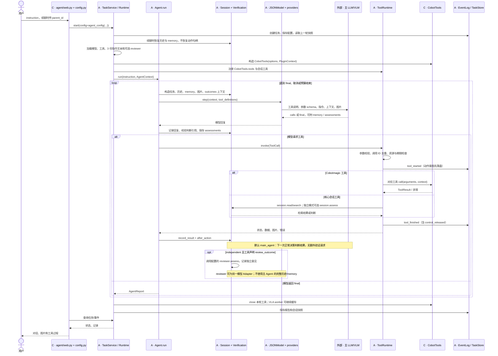
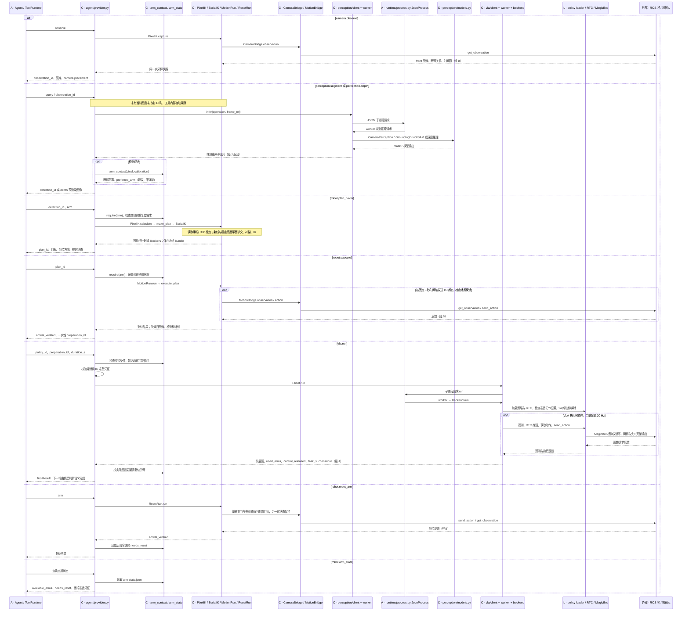
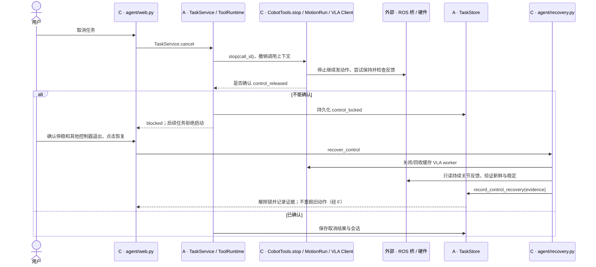

# Cobotmagic 控制流与迁移契约

依据：2026-09-28 的核心提交 `a6548d5` 与当前 Cobotmagic 扩展源码。本文是静态调用链审查；没有连接 ROS、调用模型或执行机器人动作。Cobotmagic 源码在 `feat/cobotmagic-extension` 分支纳入版本管理；感知实现已收归该扩展，不依赖其他本地扩展。

核心能复用同一套模型—工具循环。仅复制同名工具或 SKILL.md，不能保证另一台机器人的行为或成功率一致；还要对齐工具的参数、结果语义、调用前提和设备能力。

## 归属与入口

| 标记 | 所属目录 / 系统 | 职责 |
| --- | --- | --- |
| A | `src/primitive_vla/`，通用 Agent 核心 | 模型循环、工具调用、上下文、结果判断、任务记录 |
| C | `extensions/local/cobotmagic/src/primitive_vla_cobotmagic/` | Cobotmagic 应用、感知接入、IK、VLA、复位和 ROS 桥客户端 |
| L | `../agilex_lerobot/src/lerobot/` | 策略加载、RTC 推理、MagicBot 设备协议 |
| 外部 | 模型服务、机器人端 ROS 桥与硬件 | 推理服务或真实设备 |

**Cobotmagic 包内的 `agent/` 是应用适配层。真正的决策循环只有 A 的 `agent/core.py:Agent.run`。** 同样叫 `agent` 的两个目录，职责不同。

当前主入口是 `python -m primitive_vla_cobotmagic.agent --web`：

```text
[C] agent/__main__.py → agent/cli.py:main
    → agent/web.py:create_app
    → agent/config.py:agent_config
    → [A] runtime/service.py:TaskService
    → [A] runtime/session.py:Runtime
    → [A] agent/core.py:Agent.run
```

C 的根目录 `web.py` 是相机/VLM 问答页面；`ik/web.py` 是独立 IK 测试页面；`calibration/web.py` 是标定页面。它们不充当这条主 Agent 循环。A 的 `web/app.py` 是另一套通用网页，Cobotmagic Agent 网页直接复用 TaskService，没有经过该页面。

## 1. 主循环：模型决定下一步，运行时执行并反馈

以下 Mermaid `sequenceDiagram` 表达 UML 时序。参与者均标明所属；为便于阅读，相关文件在同一参与者中合并，文件索引见文末。



模型回复格式错误时，A 将错误反馈给同一任务的模型，按预算重试决策，不重放已经执行的动作。工具调用是顺序派发；一次回复可以带多个调用，但依赖上一工具结果的调用需要等下一轮。

当前 C 的配置选择 `main_agent`、未配置 finish_check。`assessments` 是可选字段，结果判断不拦截后续动作；最终任务完成状态主要由主模型判断。C 仅给 `vla.run` 设置 `review_outcome=True`；IK 和复位主要返回自身的关节/TCP 到位检查结果。

## 2. 工具内部：哪些能力由哪个扩展执行

下面是各工具分支的展开。`alt` 表示模型选择的某一次调用，不表示程序按图中从上到下自动执行所有分支。一次抓放任务通常经过观察、检测、规划、执行、VLA，但顺序由模型依据指令和工具反馈选择。



底层存在两条运动路径：IK/复位走 C 的 MotionBridge；VLA 走 L 的 MagicBot。它们共用机器人端桥，但并非同一个本地动作函数。主 LLM/VLM 不参与每个控制周期，RTC 持续运行在 VLA worker 内。

## 3. 模型决策、提示词与硬编码分别在哪里

| 行为 | 主模型负责 | 核心 A 负责 | Cobotmagic / 其他扩展负责 |
| --- | --- | --- | --- |
| 理解“先放碗，再倒蓝杯” | 分解目标、选择工具/策略、决定是否继续 | 循环和上下文，不识别 bowl/blue_cup | C 的 3 份指令提供任务说明与经验，全部随任务加载；无动态技能检索 |
| 是否先观察、补充证据、重试 | 选择下一调用，解释失败 | 将结果/错误反馈给模型，限制预算 | C 的感知工具在未有当前图时可自动取图 |
| IK 选臂 | 提交 `arm` 参数 | 不认识左右臂 | C 按标定距离生成 preferred_arm；工具说明/SKILL 引导就近选择，代码不强制选推荐臂 |
| VLA 实际用臂 | 选择策略与时长，不能强制把输出裁成准备臂 | 只派发工具 | C/L 保留完整双臂输出，由 VLA 产生动作；C 用反馈阈值统计 used_arms |
| VLA 前先 IK | 按说明规划并调用 execute | 无此顺序规则 | C 硬性要求当轮已到位的 preparation_id，消费一次；加载策略后再次检查准备关节位置 |
| 换臂前复位 | 显式调用 reset_arm；工具不会自动替它复位 | 无左右臂交接规则 | C 的 ArmState.require 拒绝在其他臂尚需复位时规划/执行/VLA；状态跨轮保留 |
| 目标三维位置 | 给出目标描述，选择检测结果 | 不做几何计算 | C 用 SAM mask 外接范围中心作为像素，射线与 base Z 平面求交，添加左右臂补偿 |
| 检测候选是否接受 | 可查看叠加图并换查询 | 不筛选目标框 | C 的 perception/models.py 内部设置边缘、大小、候选歧义、mask 像素数等过滤 |
| 运动时长和姿态 | 当前工具参数不允许改变 IK 高度/时长 | 仅执行调用预算 | C Agent 路径强制 IK 3 秒；高度、补偿、姿态来自 ik.yaml；复位时长来自 reset 配置 |
| 夹爪 | 当前无独立开/关夹爪工具给主模型 | 无夹爪逻辑 | IK 保持开度，复位回配置开度，VLA 输出可控制开度 |
| 碗倒扣、遮挡、是否倒入内容 | 依据图片和指令判断 | 默认只记录判断/证据，不证明物理真值 | C 的 SKILL 告知处理方式；没有通用代码判据保证已处理这些情况 |
| 动作是否完成 | 判断用户目标是否实现 | 验证引用、记录 outcomes；可选独立 reviewer | IK/复位校验关节和 TCP 到位；VLA 按运行时长停止并返回 task_success=null |
| 取消和错误 | 接收错误后决定下一步 | 调用 stop；未确认释放时锁定控制并持久化 | C 实现实际取消/保持/反馈检查；恢复控制由操作员网页入口触发 |

### 当前部署参数与写死的假设

这些数值不是 Agent 推理所得，也不代表其他机器人应使用相同数值：

- `configs/ik.yaml`：base Z = **0.17 m**、图片向上补偿左 **0.10 m** / 右 **0.15 m**、向下角度 **40–90°**、优先更朝下、保持两指连线的水平朝向。此处“悬停”不等于测量物体高度后再加 10 cm。
- `agent/motion.py:DURATION_S = 3.0`，provider 会覆盖传给 PixelIK 的时长。修改 ik.yaml 的时长并不能改变 Agent 这条入口；独立 IK 入口另走配置。
- 当前 reset 配置：左右六关节回零、夹爪回 **0 m**，名义 **3 秒**；这三个值可以在 C 配置中改。reset 工具描述却把“3 seconds”写成固定文字，换配置时描述与执行存在不一致风险。
- `ik/config.py`、`ik/execution.py` 和 `vla/backend.py` 固定假设左右两臂、每臂 6 关节＋夹爪、VLA 14 维；IK 还与代码中的 MagicBot 桥关节限位取交集。换 URDF 不能自动适配任意构型。
- 固定使用已标定的 front 相机；IK 快照最长 180 秒、图像/关节时间差 400 ms 等检查在 C 的代码里。图片尺寸和外参/TCP 必须对应当前机器人。
- `perception.depth` 仅提供 DepthAnything 预测，**不参与当前 IK 坐标计算**。GroundingDINO/SAM、DepthAnything 和本地权重加载均在 C 的 `perception/models.py` 中实现；不包含 GGCNN 抓取或仿真执行。
- VLA 的 checkpoint、训练指令、频率、时长范围在 C 的 agent.yaml；模型通过 L 的 RTC/MagicBot 执行。主模型提交 duration_s；YAML 中各 policy 的 duration_s 通过工具说明给它参考，max_duration_s 被代码检查。实际动作不能仅凭接口名称迁移到另一构型。
- 图像刷新或实际运动使旧检测/计划失效；仅前置检查失败且未发送动作时会保留现场数据。计划与准备凭证仅属于当轮；聊天续接不会恢复这些可执行句柄。

### 当前并未强制的语义约束

`preparation_id` 证明某次 IK 到位准备已经发生，并包含该臂的关节位置。`vla.run` **没有核对该准备对应的是碗还是蓝杯，也没有把 detection_id 与 policy_id 做目标语义绑定**。使用正确目标主要由模型遵守工具/SKILL 说明。这与“先 IK”确实被代码强制是两回事。

工具公共返回壳是 `ToolResult`，但 `data` 仍为任意字典；当前 C 的工具未声明 output_schema。框架能校验通用壳和输入参数，不能保证另一个实现里的 `arrival_verified`、`used_arms` 或 `pixel_uv` 表达同样含义。

## 4. 取消、控制锁和恢复归属



C 的 IK/复位路径以 `completed or not sent` 表示 control_released；动作中途取消且已发指令时不能仅凭保持指令就声称停止。VLA 路径额外做稳定反馈检查。A 信任扩展所报告的执行状态，保存通用锁；它不会直接检查机器人。

## 5. 迁移需要保持什么

**无需修改主 Agent 循环即可接入另一台机器人；当前没有“给同名模型入口就保证效果相同”的保证。** 可以把需求分成三层：

| 一致性层级 | 最少需要一致的内容 | 仅有同名工具是否足够 |
| --- | --- | --- |
| 能接入 | factory(options, PluginContext)、tools 列表、ToolDefinition、async call/stop、ToolResult、资源/取消约定 | 不足，需符合公开接口 |
| 行为可替换 | 输入/输出语义、描述与指令、单位/坐标系、图片语义、前提、凭证有效期、错误与完成含义 | 不足，当前没有统一 IK/VLA 领域契约来自动保证这些 |
| 物理效果相近 | 标定/构型/可达空间、相机位置、模型权重与训练分布、控制协议/频率、延迟、夹爪及目标状态 | 不能只靠软件接口保证，需要在新设备验证 |

如果新机器人提供等价的工具语义和可靠反馈，主 Agent 可以继续使用同一套任务循环；设备配置、模型适用范围和机器人专用指令仍需适配。原样复制 Cobotmagic 的左右臂复位规则、3 秒时长和目标平面补偿并不合适。

SKILL.md 只是送给模型的指令文本。真正的可执行能力是工具 Interface。技能中的建议、工具里硬性检查的前提、设备驱动约束必须分别写清楚，才能判断另一个实现是否等价。单纯让两个模块都叫“检测、IK、VLA”不满足这个条件。

## 文件索引与数据生命周期

以下索引覆盖图中的模块与其辅助文件；包标记和静态页面文件不单独作为执行参与者。

| 所属 | 模块 | 负责的调用/状态 |
| --- | --- | --- |
| A | [runtime/service.py](../src/primitive_vla/runtime/service.py)、[storage/tasks.py](../src/primitive_vla/storage/tasks.py) | 任务启动/取消、续聊、SQLite 任务/事件/会话和通用控制锁；不理解左右臂或对象 |
| A | [runtime/session.py](../src/primitive_vla/runtime/session.py)、[composition.py](../src/primitive_vla/runtime/composition.py)、[lifecycle.py](../src/primitive_vla/runtime/lifecycle.py) | 每轮创建模型/工具，解析 factory，读取 instructions，关闭资源 |
| A | [agent/core.py](../src/primitive_vla/agent/core.py)、[contracts.py](../src/primitive_vla/agent/contracts.py)、[memory.py](../src/primitive_vla/agent/memory.py) | 决策循环、模型输入输出类型、历史检索和会话快照 |
| A | [agent/model.py](../src/primitive_vla/agent/model.py)、[providers/](../src/primitive_vla/providers/) | 通用提示、工具 schema、JSON 决策协议和 HTTP/Codex 通信；模型服务在外部 |
| A | [tools/contracts.py](../src/primitive_vla/tools/contracts.py)、[tools/runtime.py](../src/primitive_vla/tools/runtime.py) | 公共工具壳、派发、输入校验、资源、调用去重、取消；HTTPTools 是另一可选 provider，不在当前 C 链路 |
| A | [verification/](../src/primitive_vla/verification/) | contracts 类型、images 选图、outcomes 记录、runtime 调度；model.py 仅配置独立模型 reviewer 时使用 |
| A | [config/](../src/primitive_vla/config/)、[storage/events.py](../src/primitive_vla/storage/events.py)、[runtime/process.py](../src/primitive_vla/runtime/process.py) | 通用配置、日志、JSON worker 通信；不定义机械臂协议 |
| C | [agent/cli.py](../extensions/local/cobotmagic/src/primitive_vla_cobotmagic/agent/cli.py)、[config.py](../extensions/local/cobotmagic/src/primitive_vla_cobotmagic/agent/config.py)、[web.py](../extensions/local/cobotmagic/src/primitive_vla_cobotmagic/agent/web.py) | 应用入口、配置组装、网页/恢复入口、工具结果的页面展示过滤 |
| C | [agent/provider.py](../extensions/local/cobotmagic/src/primitive_vla_cobotmagic/agent/provider.py) | CobotTools 工具目录及硬性调用前提；当前图像、检测、计划、准备凭证属于单轮实例 |
| C | [agent/arm_context.py](../extensions/local/cobotmagic/src/primitive_vla_cobotmagic/agent/arm_context.py)、[arm_state.py](../extensions/local/cobotmagic/src/primitive_vla_cobotmagic/agent/arm_state.py) | 就近用臂依据；独立 `arm-state.json` 跨轮保存 needs_reset，不在核心 TaskStore 中 |
| C | [agent/motion.py](../extensions/local/cobotmagic/src/primitive_vla_cobotmagic/agent/motion.py)、[reset.py](../extensions/local/cobotmagic/src/primitive_vla_cobotmagic/agent/reset.py)、[recovery.py](../extensions/local/cobotmagic/src/primitive_vla_cobotmagic/agent/recovery.py) | IK 执行、复位与操作员恢复流程 |
| C | [ik/pixel.py](../extensions/local/cobotmagic/src/primitive_vla_cobotmagic/ik/pixel.py)、[config.py](../extensions/local/cobotmagic/src/primitive_vla_cobotmagic/ik/config.py)、[kinematics.py](../extensions/local/cobotmagic/src/primitive_vla_cobotmagic/ik/kinematics.py)、[execution.py](../extensions/local/cobotmagic/src/primitive_vla_cobotmagic/ik/execution.py) | PixelIK 几何/标定读取、参数、SerialIK、路径/桥执行；磁盘 bundle 不是跨轮可执行授权 |
| C | [bridge.py](../extensions/local/cobotmagic/src/primitive_vla_cobotmagic/bridge.py)、[calibration/core.py](../extensions/local/cobotmagic/src/primitive_vla_cobotmagic/calibration/core.py) | CameraBridge 与图像解码；IK 复用内参检查。标定采集/求解是离线准备，不在每次动作内运行 |
| C | [perception/](../extensions/local/cobotmagic/src/primitive_vla_cobotmagic/perception/) | 客户端/worker/CameraPerception；本地模型加载、分割过滤与深度预测。推理进程按轮关闭 |
| C/L | [vla/](../extensions/local/cobotmagic/src/primitive_vla_cobotmagic/vla/) | C config/client/worker/backend；工作区缓存 worker 与策略，finish_turn 结束当轮运行；L 负责策略/RTC/MagicBot |
| C | [configs/agent.yaml](../extensions/local/cobotmagic/configs/agent.yaml)、[ik.yaml](../extensions/local/cobotmagic/configs/ik.yaml)、[skills/](../extensions/local/cobotmagic/skills/) | 本机模型与动作配置、三个领域指令文件；由 Runtime 作为文本加载 |

当前扩展里的耦合主要集中在 CobotTools、PixelIK 和 VLA Backend。核心已经避免直接导入这些机器人实现；下一步若要提升迁移一致性，应先定义要兼容的工具语义，再让另一机器人实现该语义，并用同一套契约测试核对。当前没有修改这些实现。
