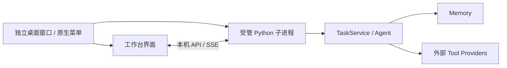

# Primitive 桌面工作台

这是独立桌面窗口，界面由 Electron 承载，本地 Python Runtime 负责 Agent 运行。
主进程启动并持有 Runtime 子进程，界面通过本机 HTTP 和 SSE 读取状态；不依赖外部网站。



## 从源码启动

需要 Python 3.10+、Node.js 22.12+（推荐 Node 24），以及正常的桌面图形会话。

```bash
python3 -m venv .venv
.venv/bin/python -m pip install -e '.[gui,test]'
npm --prefix desktop ci
npm --prefix desktop run setup
.venv/bin/primitive-vla desktop
```

Electron 45 的 npm 包将下载运行时作为单独步骤，`setup` 会下载锁定版本的官方运行时。
启动时自动选择空闲的回环端口，不需要手动打开浏览器。
也可执行 `PRIMITIVE_PYTHON=/绝对路径/python npm --prefix desktop start`；这个环境变量仅选择 Python 环境。

Python 命令默认使用当前目录的 `workspace/agent`。直接通过 Electron 启动时，默认工作区在应用的用户数据目录，
Linux 通常为 `~/.config/Primitive/workspace`。可以显式传入同一工作区：

```bash
.venv/bin/primitive-vla desktop --workspace /绝对路径/agent-workspace
```

未注入 Planner 时，应用提供真实的草稿保存、历史记录与 Memory 浏览；“运行任务”不可用。
程序不会注册演示模型、机器人或预设工作流。测试替身只存在于测试目录。

使用已配置的 DeepSeek Flash 与 RoboCasa，可运行 `bash scripts/start-deepseek-desktop.sh`，
配置、模型请求与仿真 episode 的生命周期见 [RoboCasa 接入](robocasa.md)。

首次启动会创建文件记忆工作区，目录与生命周期见 [Memory 说明](memory.md)。
应用可以通过 `create_app(..., organizer=MemoryOrganizer(memory, vlm))` 启动定时长期整理；
默认草稿入口仅做 TTL 与索引维护，后台状态可在 `/api/status` 的 `memory_maintenance` 中读取。

## 界面能力

- **工作台**：任务输入、最近任务、搜索、执行时间线，支持实时事件更新和历史记录读取。
- **任务控制**：运行、暂停决策、恢复、请求停止、重新确认停止；等待用户时可回复文本和结构化数据。
- **上下文面板**：Runtime 与机器人状态、控制资源占用、最近 Verification 结论、预算使用情况。
- **机器人视角**：右侧面板自动加载所选机器人的默认相机，支持切换、放大、收起和最后采集时间。
  Provider 未提供能力时明确显示不可用；隐藏面板或最小化窗口会退订，恢复可见时重新订阅。
  画面中断后显示错误与最后采集时间，点击「重新连接」重试。放大使用同一条订阅。
- **Memory**：关键词检索、工具域/生命周期过滤、分页及当前工作记录查看；执行时间线独立保留原始历史。
- **工具与 Skill**：从 Registry 读取真实能力描述、输入/输出 Schema、资源要求及关联 Markdown 文档。
- **资源**：本地图片预览、其他资源下载、外部资源引用查看。
- **桌面体验**：原生菜单、独立窗口、深浅主题、键盘快捷键、单实例启动；窗口内部可调整上下文面板。

快捷键：`Ctrl/⌘ N` 新任务、`Ctrl/⌘ K` 搜索、`Ctrl/⌘ Enter` 提交任务/回复、`Esc` 关闭弹窗。

## 接入现有 Agent

在宿主模块中提供工厂函数。工厂返回应用，不预先启动额外的 Session runner：

```python
from primitive_vla.interfaces.web import create_app
from primitive_vla.interfaces.web.app import RobotProfile


def create_workbench():
    agent = build_your_agent()  # 应用已有的 Planner、Provider、Memory 和资源拓扑
    return create_app(
        agent,
        robots=(RobotProfile(id="robot-01", type="your-robot-type", label="实验室机器人"),),
    )
```

```bash
.venv/bin/primitive-vla desktop --factory your_app:create_workbench
```

机器人 ID 必须与 Agent 的资源拓扑一致；RobotProfile 的 type 对应 ToolSpec.supported_robots。
使用工厂时，以工厂创建的 Memory 为准，`--workspace` 不替换工厂配置。
模型 API、凭据和具体机器人能力仍由应用自己的配置处理，桌面界面不擅自添加这些能力。
可选 `view_sources={robot_id: provider.views}` 注入机器人视角，接口与生命周期见
[机器人视角](robot-views.md)。现有 RoboCasa 桌面装配已经连接该能力，无需额外启动相机服务。

如果只是调试界面，可以额外启动浏览器入口：

```bash
.venv/bin/primitive-vla gui --port 8765
```

该入口默认仅监听 `127.0.0.1`，不是远程多用户服务。对外托管、用户认证和远程机器人权限管理不在此版本范围。

## 关闭与动作停止

暂停按钮只停止高层决策，不代表机器人停止运动。退出桌面应用时，若有活动任务，原生提示框询问
是否停止任务并退出。确认后先暂停决策，再请求 Provider 停止。

只要有动作无法确认停止，退出接口返回冲突，窗口保持打开，控制资源继续被占用。
应用不会使用“杀掉 Python 进程”来冒充机器人已停止。没有活动任务时正常关闭，不重复确认。
应用崩溃/系统强制退出后的动作恢复遵循 Runtime 原有的隔离与停止确认协议。

桌面专属连接使用每次启动生成的随机令牌；令牌仅在主进程和子进程之间传递，Renderer 不接触令牌。
Renderer 关闭 Node.js 集成并启用上下文隔离、沙箱；不允许跳转到外部站点。
实现参考 [Electron 官方安全指南](https://www.electronjs.org/docs/latest/tutorial/security)。

## 打包与验证

```bash
npm --prefix desktop run package
```

当前打包脚本生成 Linux 目录：`desktop/dist/Primitive-linux-x64/`（架构名称随运行环境变化）。
目录内包含 Electron 可执行程序、桌面入口、界面及 Python 框架源码。
**Python 解释器和 Python 依赖没有打包进去**，可使用现有环境，或按包内 README 创建虚拟环境。
运行 `Launch-Primitive.sh` 启动；工作区默认保存在用户数据目录，不在安装目录内。

macOS/Windows 可从源码运行；尚未提供这两个平台的安装包、签名或公证。

```bash
.venv/bin/python -m unittest discover -s tests -t . -v
PRIMITIVE_PYTHON="$PWD/.venv/bin/python" npm --prefix desktop test
```

测试覆盖 HTTP 控制到真实 Runtime 的调用、停止确认、SSE 快照、资源边界、桌面启动/退出链路，
以及 jsdom 中的提交、回复、工具筛选、Memory 详情、主题和快捷键。
jsdom 不是实际图形渲染。2026-11-12 已连接本机 X11 图形会话，实际启动独立窗口并检查截图；
确认默认草稿界面及 DeepSeek + RoboCasa 工具页正常显示。这不等于所有交互与平台均完成视觉验收。
同日，机器人视角通过真实 Electron/X11 窗口验收：GPU 相机画面、放大、切换、深浅主题及窄窗口布局；
收起、隐藏面板、最小化与关闭窗口均实际终止订阅。检查期间没有调用模型。
