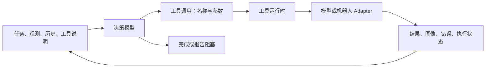

# 由模型自主调用工具的具身 Agent

状态：历史设计记录，正文中的“当前”指提案写作时的代码。工具循环、插件配置、历史检索和 HTTP 工具已实现；后续清理已移除旧场景包装、符号技能和内置仿真/VLA。实际接口以 [当前架构](architecture.md)和[工具接入](tools.md)为准。本文保留原始讨论与草图，包含已经删除的模块和未实现的 Adapter 占位名称。

## 1. 设计方向

任务中的“下一步做什么、调用哪个模型、是否需要先定位或重新观察、如何处理失败”由决策模型负责。框架提供工具发现、调用、反馈、上下文、资源管理与执行约束。

上一版提案将定位、IK、VLA 组织成框架主导的执行配方，放入了过多任务顺序。本次修订将这些能力直接暴露为工具。工具作者仍可提供便捷的组合工具，但 Agent 也能使用其基础能力，核心不要求固定配方。

用户给出的循环可以作为设计起点。公开 OpenAI 文档描述的通用 Agent 循环也是模型输出工具调用、运行工具、将结果送回模型并继续，直到得到最终响应：[Running agents](https://developers.openai.com/api/docs/guides/agents/running-agents)。这里借鉴这一交互机制，不将用户的伪代码宣称为 Codex 或 Claude Code 的完整内部实现。

## 2. 当前代码为什么还不是这种 Agent

当前运行方式大致为：

```text
把用户要求解析成已有布尔谓词
→ Registry 枚举技能和对象参数的组合
→ VLM 从合法候选中选择一个编号
→ Executor 执行该候选
→ 观察和比较预定义效果
```

具体限制：

- `agent/decision.py:VLMDecisionModel` 返回候选 index，不能自由生成任意工具名和符合工具 schema 的参数。
- `agent/task_parser.py` 要求目标对应现有 facts；`agent/core.py` 的完成条件也依赖它们。
- `domain/skills.py:Registry` 根据对象类型枚举参数，`hand` 还有专门分支。
- `SkillSpec` 把技能说明与原子执行、前置谓词和 effects 绑定，增加能力时容易被迫加入符号规则。
- 已有 memory 保存事件，但决策没有使用完整的任务工作记忆；固定最近几条结果不适合长期试探。

现有模型客户端、进程通信、日志、取消和控制权代码仍有复用价值。`effects.py` 和 RuleVerifier 可保留为特定工具的实现；它们不再定义所有任务的通用完成语义。

## 3. 核心只需要四个职责

| 模块 | Interface 与职责 | 新能力从哪里进入 |
| --- | --- | --- |
| Agent loop | 组织模型轮次、接收工具调用或最终响应、管理总预算 | 不包含厨房、电池或机器人构型分支 |
| Model Adapter | 输入上下文与工具定义，输出 ToolCall / Final；保留模型协议需要的续接信息 | 替换决策 LLM/VLM |
| Tool registry/runtime | 发现工具、提供说明、验证参数、派发与取消调用、返回结果 | 模型、机器人、仿真器、定位器、世界模型 |
| Session/context | 保存对话、调用结果、媒体证据和工作记忆；按预算构造下一轮输入 | 不要求所有信息都变成布尔 facts |



所有模型能力和机器人能力通过同一个工具调用 Seam 进入核心。只有真正需要互换的工具才共享具体的输入输出契约。无需让新能力先归属于固定的定位、规划、验证类别，也无需为每种模型增加一个核心 Protocol。

例如某个未来工具可以返回触觉重建、音频判断或轨迹评分。只要它能描述自己的参数、输出与执行行为，Agent 就能看到并调用它；接入过程不要求改 Agent 循环。

## 4. 循环与工具接口草图

```python
# 交互草图；实际运行时还须在异常、取消和预算耗尽时结束活动调用。
session = Session(task=user_instruction)
session.add(initial_observation)

while budget.available():
    reply = await model.step(
        context=session.context(),
        tools=registry.definitions(),
    )
    session.record_reply(reply)

    if reply.is_final:
        # 通用终止检查：没有遗留的活动控制调用。
        # 声明任务成功、失败或阻塞；保留理由与证据。
        return await runtime.finalize(reply, session)

    for call in reply.tool_calls:
        # 验证工具名、schema、授权与资源；调用工具自己的执行检查。
        # 拒绝和可恢复错误也作为结果返回，供下一轮决策。
        result = await runtime.invoke(call)
        session.record_result(call.id, result)

return await runtime.stop_and_report("budget_exhausted")
```

首版按顺序派发工具，多条存在数据依赖的调用分轮完成。支持并行后，也由运行时管理真实资源冲突；模型不能靠同时返回多个调用获得同一机械臂的并发控制权。

`observe` 也可以是工具，模型按需要选择相机、时间窗口或观察目标。运行时可持续提供低成本状态更新；不要求每做一次纯计算就强制重拍图像。机器人本地控制监测独立于模型轮次运行。

工具最小形状：

```python
class Tool(Protocol):
    # 名称、说明、JSON Schema、输出说明，以及资源/副作用声明。
    definition: ToolDefinition

    async def call(self, arguments: dict, context: CallContext) -> ToolResult: ...
```

`ToolResult` 的公共外层包含 call ID、调用状态、结构化数据、文本/图像等内容、错误和证据引用。具体业务数据由工具自己的 schema 描述。调用状态成功只表示工具正常执行，不能被统一解释为用户目标达成。

例如定位工具返回检测结果；IK 工具返回可执行的计划引用或无法求解的理由；VLA 工具返回执行轨迹和实际控制状态。资源引用需要保留所属环境、时间戳和有效性；机器人 Adapter 在执行前校验，模型不能伪造一个计划引用就使其生效。

长动作由运行时管理 operation ID、状态与取消。停止确认之前不释放控制权；网络超时不能自动重放可能已执行的物理操作。纯读取工具则可以采用不同的重试策略。

图像不能仅以一个模型无法访问的路径进入 prompt：Session 保留媒体引用，Model Adapter 将可用图像内容转换为相应模型支持的输入格式。大数据保留为可检索的 artifact，工作记忆只压缩事实摘要、已试方案、证据引用和未解决问题。

## 5. “告诉 Agent 怎么调用”具体是什么

一个能力包提供工具实现、工具说明及可选的使用文档。例如工具 `vla.pour_yellow`：

```text
用途：调用黄色杯倾倒策略。
参数：robot_id、source_id、target_id。
输入要求：模型指定的相机与机器人状态。
运行条件：目标可见；机器人位于本策略支持的入口范围。
使用提示：若入口条件不满足，可用感知与运动工具进行准备。
返回：执行状态、实际轨迹、后续观测引用；液体是否已倒入需观察确认。
```

模型根据说明自行决定如何准备。它可以调用已有定位工具，也可以在已有有效定位结果时复用；可以先检查碗的状态，也可以根据错误反馈补充证据。

在框架层不编写“先调用 detector A，再调用 IK B，最后调用 policy C”的任务分支。硬性的接口条件由工具作者实现：例如入口条件不满足时返回可解释的错误，并且不派发动作。自然语言说明帮助模型提前正确调用，运行时检查防止错误调用产生不受支持的行为。

可选的 skills 文档用于给模型提供经验和示例。这与当前强制包含 preconditions/effects 的 SkillSpec 是不同概念：经验文档不会变成调度器，也不是预先穷举全部情况。

## 6. 任意机器人与任意模型的含义

机器人包按自身真实能力导出工具与说明：例如双臂机器人提供手臂运动和夹爪工具，移动机器人提供导航工具，灵巧手提供抓取配置工具。资源名称、关节、坐标系与传感器由包描述；核心不写死左右臂、七关节或夹爪开度。

不强制所有机器人实现同一套厨房动作。共同点是工具调用协议，不是统一硬件形状。必要的共同约定是调用身份、生命周期、媒体/数据引用；具体关节与动作类型留在该工具的 schema 和实现中。

决策模型通过 Model Adapter 接入；VLA、定位模型、世界模型等专用模型作为工具接入。底层可以是 Python 对象、HTTP、子进程或 ROS；将来有需求再加 MCP 等传输 Adapter，传输不改变 Agent 的决策逻辑。

“可以接入”表示无需修改核心即可暴露能力，不保证模型能正确使用任何陌生工具，也不保证一个机器人的 VLA 自动适配另一个构型。训练分布、传感器输入、动作含义和机器人兼容性由能力包明确声明并校验。真实不兼容应返回原因，不能只改关节数组长度后继续运行。

## 7. 五个故事如何使用同一个循环

下表是模型可能做出的选择示例，不是需要写入核心的固定流程。

| 故事 | 提供的工具 | 模型负责决定 |
| --- | --- | --- |
| 电池试探 | 观察、装入电池、调整指定侧电池 | 看表、调整哪侧、何时补充观察、避免重复无效试验、何时报告无法完成 |
| 真机多个 VLA | 观察、定位、IK/运动、多个 VLA | 是否先检查碗和杯子、如何准备入口、调用哪个模型、失败后怎么处理 |
| 纯 IK 抓取 | 观察、几何/抓取估计、IK、夹爪开关 | 如何获取足够几何信息、选择抓取方案、执行与验证；不注册 VLA 工具 |
| 世界模型 | 预测或评估工具 | 需要时调用预测帮助选择；调用实际证据评估工具检查效果 |
| 替换定位 | 相同定位契约的另一个 Adapter | 工具名与输出契约不变时，沿用同一调用方式 |

例如用户要求“倒入黄色液体并搅拌”，模型可能先观察，再定位杯子，调用 IK，调用黄色倾倒 VLA，观察效果，最后选择搅拌。若第一帧就看到碗倒扣，它可直接报告阻塞。若某个 VLA 已能自行接近目标，就不必经过相同的准备步骤。

无需在核心增加 `if battery`、`if bowl_inverted` 或 `if world_model`。具体任务的顺序和恢复行为通过模型读取工具说明、历史与实际反馈得出。

对于纯 IK 抓取，感知与几何计算仍需提供足够的信息；可派发的物理操作只有 IK 和夹爪开关。缺少必需的几何或控制能力时，Agent 应报告不足，不能靠语言推理补造精确坐标。

## 8. 验证也应开放

用户伪代码中的 `verify(result)` 需要区分两个职责：

- 调用检查：参数是否合法、工具是否报错、动作是否停止。这些由运行时与工具实现。
- 效果判断：电源表是否转动、液体是否倒入、抓取是否成功。这些由模型结合实际反馈判断，也可由模型调用专门的评估工具。

因此核心不强制每次工具调用后再执行一个固定 Verifier。模型可以自己看图，可以选择测量工具，也可以使用世界模型评估。预测“可能成功”与实际观察“已经成功”在结果中明确标识。

最终响应保留 `completed / blocked / failed`、理由和证据引用。部署若要求指定模型或 benchmark evaluator 验收，可配置结束检查；该检查的任务知识属于可替换 Adapter。检查未通过时把原因返回循环，不能静默覆盖已有证据。

需要承认通用模型仍可能误判成功。参考工具调用日志、真实观测和任务评测来衡量这种误判，不能靠在核心里继续增加任务谓词就宣称解决了它。

## 9. 配置只负责装配

下面是拟议配置，路径均为待实现 Adapter；不是现有可运行配置：

```yaml
model:
  adapter: project_plugins.reasoner:Model
  options:
    endpoint: http://127.0.0.1:9000

tool_providers:
  - adapter: project_plugins.ros_dual_arm:Tools
    options:
      profile: robots/dual_arm.yaml
  - adapter: project_plugins.vla_models:Tools
    options:
      manifest: models/kitchen.yaml

tools:
  perception.locate:
    adapter: project_plugins.grounding_dino:Locate
    options:
      checkpoint: /models/grounding-dino

instructions:
  - skills/robot_usage.md
  - skills/kitchen_models.md
```

替换定位时，将 `perception.locate` 的 Adapter 和模型选项换成轻量 VLM 实现。保持这个工具的输入输出语义，其他调用方无需修改。如果新能力输出的是另一种数据，例如从二维框变成空间姿态，则由 Adapter 转换或作为新工具暴露，不能把不相容结果伪装成同一个契约。

工具很多时按名称/描述检索和按需加载完整说明，不一次把所有 schema 与长文档塞入上下文。先做小规模静态注册，出现上下文压力后再增加发现工具。

## 10. 对现有仓库的最小改造路线

| 改造位置 | 改动 |
| --- | --- |
| `agent/contracts.py` | 将“选择 Candidate”改为 ToolCall(name, arguments, id) / Final；上下文包含会话与工具定义 |
| `agent/core.py` | 改成模型—工具—反馈循环；去掉强制候选枚举、Task.pending 完成条件、任务特定重试分支 |
| `agent/decision.py`、`providers/` | 输出工具调用并校验结构；支持原生工具调用或结构化 JSON Adapter，保留对应协议的消息关联 |
| `domain/skills.py`、`agent/task_parser.py` | 从核心必需依赖降为旧技能/结构化任务的可选支持；自然语言目标可直接进入会话 |
| 新增 `tools/` | 注册表、统一返回外层、参数校验、工具派发；具体模型与机器人实现独立 |
| `execution/` | 复用期限、控制租约、停止、动作校验；逐步解除对 SkillSpec 的依赖 |
| `agent/memory.py` | 保存完整调用与结果，维护可检索的证据和工作摘要，避免只截取最后几条结果 |
| `runtime/session.py`、`config/` | 从配置组装决策模型和工具；统一启动/关闭，不写死 VLA 对应 SAPIEN |
| `verification/` | 保留规则实现作为可注册工具或可选结束检查，不强制所有任务走这套规则 |

第一步只做一个可运行的通用工具循环：将已有 Mock 或模拟器能力包装成工具，让模型从原始指令选择名称与参数。已有技能可以先逐个包装，逐渐暴露定位、运动等基础工具，避免一次推翻可运行执行代码。

验收以核心不变为准：新增工具只修改实现、说明和配置；替换机器人不修改 Agent；不注册 VLA 时仍能使用其他工具；一次失败的结果能引发不同的后续选择；模型无需依赖预定义事实词典才能理解任务。

工具契约测试负责输入输出与执行约束。Agent 行为评估允许多种有效调用顺序，只检查目标、有效证据和实际执行约束；不通过断言固定工具序列，重新把任务流程写回测试。
