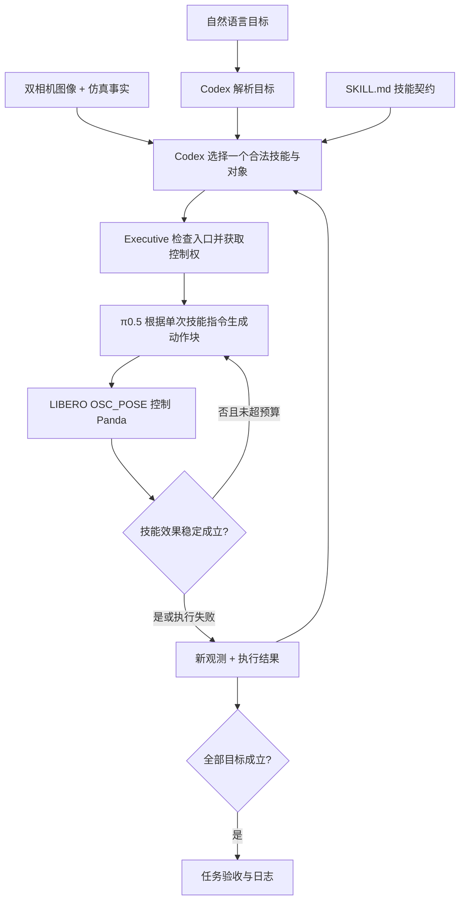

# Codex Agent → π0.5 → LIBERO：真实闭环演示

这条路径接入项目原有的 `TaskParser → StructuredPlanner → Agent → Executive → Verifier`，低层后端改为 LIBERO / π0.5。此前 `benchmarks/libero/run.py` 的 9/10 结果是独立策略评测，没有经过 Agent；两者分别保存、分别报告。

## 已运行的任务

用户指令：**“把字母汤罐头和奶油奶酪盒都放进篮子，搬运顺序由你决定，不要移动其他物体。”**

只向 `/api/tasks` 提交 `instruction`，没有提交任务 JSON、预设动作序列或物体执行顺序。

**2026-09-15 实测成功**：LIBERO-10 task 7，官方初始状态 0，seed=7。两个目标均成立、夹爪空闲，原始 LIBERO 总任务谓词也为 true。任务 ID：`052395919ad44e08bba8e3512b147bce`。

**[打开 Agent 工作台与本次记录](http://127.0.0.1:8084/?task=052395919ad44e08bba8e3512b147bce)** · [完整任务录像](http://127.0.0.1:8084/api/media/libero-8a733a012e9f.mp4)

| 阶段 | 本次实际行为 | 调用与结果 |
|---|---|---|
| 目标解析 | Codex 将自然语言解析为汤罐头入篮、奶酪盒入篮两个目标；没有强制先后关系 | 1 次 Codex 调用 |
| 第一次规划 | 从汤罐头、奶酪盒、番茄酱罐头、番茄酱瓶四个候选中选择汤罐头 | 1 次 Codex 调用 |
| 第一次执行 | `TRANSFER(object=alphabet_soup, destination=basket)` | 26 次 π0.5 推理、128 步控制，成功 |
| 技能交接 | 物理事实确认汤罐头入篮、夹爪不再抓住物体；释放本次控制租约 | 同一场景继续，未重置 |
| 第二次规划 | Codex 看到已完成目标和第一段执行结果，选择剩余的奶酪盒 | 1 次 Codex 调用 |
| 第二次执行 | `TRANSFER(object=cream_cheese_box, destination=basket)` | 23 次 π0.5 推理、111 步控制，成功 |
| 最终验收 | 两个物理目标及 LIBERO 原始总任务谓词成立；Codex 审阅成功 | 1 次 Codex 调用 |

共 **4 次 Codex GPT-5.5 / medium 调用、49 次 π0.5 推理、239 步控制**。从初始证据到最终验收约 126.4 秒，包含模型加载和远端 Codex 延迟；π0.5 调用耗时中位数 242.48 ms。该数字来自本次 Agent 演示，不与独立 benchmark 的时延混用。

第二次规划的真实简短理由是：“剩余目标只要求将奶油奶酪盒放入篮子；字母汤罐头已在篮中且右手空闲。选择搬运奶油奶酪盒，避免移动番茄酱罐头和番茄酱瓶等干扰物。”这是模型公开返回的决策说明，不是其内部思维链。

## Agent 和 VLA 分别决定什么



| 内容 | 来源 |
|---|---|
| 用户目标解析、下一件物体、技能绑定、下一步简短理由 | Codex 模型返回 |
| 每一步末端平移、旋转和夹爪控制 | π0.5 LIBERO 权重返回 |
| 技能名称、入口、效果、提示词模板、重试上限 | `skills/libero/transfer/SKILL.md` |
| 对象 ID 与 MuJoCo 物体对应、空间谓词映射、模型路径与运行预算 | `configs/libero-agent.json` |
| 动作反归一化、OSC 控制器、租约、停止与过期动作拒绝 | 确定性程序 |
| 入篮事实 | LIBERO 原始 `_eval_predicate`，来自物理仿真真值 |
| 夹爪是否持物 | robosuite `_check_grasp`，根据物理接触判断 |

`TRANSFER` 是完整抓取、搬运、释放操作。**Python 没有写死先搬汤罐头再搬奶酪盒，也没有写死抓取轨迹。** 技能提示词是 `put the {object} in the {destination}`，参数由 Agent 的候选选择绑定；每件物体都单独触发一次高层规划。

每项技能要求目标入篮且夹爪不再持物，连续满足配置的 5 个控制步才完成，以避免在仍抓着物体时交接。失败后返回原来的世界状态，由 Agent 重新选择；执行器不会自动重置世界或把整条任务转交给 VLA。

本次两个干扰物没有被 Agent 选作操作目标，最终也没有进入篮子；没有据此声称它们的位姿绝对不变。

## 源码位置

| 模块 | 职责 |
|---|---|
| `agent/task_parser.py`、`planner.py`、`loop.py` | 复用已有目标解析、候选选择、执行后重规划 |
| `execution/executive.py` | 复用已有控制权限、监控与效果验收 |
| `backends/libero.py` | 将 Agent 单次技能调用转换为 VLA 闭环，完成后交还上层 |
| `simulation/libero_worker.py` | 一个任务持有一个物理世界；处理相机、接触、空间谓词、动作、录像 |
| `vla/libero.py` | 与独立 benchmark 共用的 π0.5 输入输出适配 |
| `vla/libero_worker.py` | 在模型 Python 环境执行推理 |
| `runtime/process.py` | 任务持有的子进程及请求/响应生命周期 |
| `skills/libero/transfer/SKILL.md` | 文件化的参数化搬运技能 |

主进程只依赖原有网页/Agent 环境；MuJoCo 使用本机 `libero` 环境，模型使用 `pi` 环境。与 SAPIEN 的共享部分保持在 Agent、执行管理、网页和模型严格加载层，仿真专用实现分别放置。

## 配置与运行

```bash
.venv/bin/python -m primitive_vla serve \
  --config configs/libero-agent.json --workspace workspace/libero-agent
```

打开 **http://127.0.0.1:8084**。默认示例允许 Agent 自选顺序；第二个示例要求先奶酪盒再汤罐头，可用于后续测试目标依赖。当前只报告上面的自选顺序实测，未把其他示例算作成功结果。

配置入口：

- `planner` / `parser` / `vlm`：高层模型、提示词、推理强度。
- `backends.libero.libero.policy`：checkpoint、统计、分词器、推理精度、动作时域。
- `backends.libero.libero`：任务编号、初始状态、种子、单技能最大控制步数、执行前缀、稳定成功步数、相机和频率。
- `scene.objects`、`objects`、`predicates`：逻辑对象与物理场景的映射。换 LIBERO 任务时需一起匹配，不能只改 task ID。
- `skill_sources`：技能 Markdown 目录。

## 证据与边界

[任务与配置快照](../workspace/libero-agent/exports/052395919ad44e08bba8e3512b147bce/task.json) · [完整事件日志](../workspace/libero-agent/exports/052395919ad44e08bba8e3512b147bce/events.jsonl)。物理动作、每次 π0.5 输入和环境初始化信息位于 `workspace/libero-agent/runs/libero-8a733a012e9f/`。网页可查看四次高层模型调用、候选、简短理由、VLA 动作块及效果验收。

已实际验证两个技能间保持同一世界、停止后拒绝旧动作块、被撤销的迟到模型输出不能继续驱动仿真。成功结果只来自这一次双目标演示，尚未完成 Agent 层的大规模 benchmark。

当前状态使用仿真真值，并非纯视觉感知系统。LIBERO 专用 π0.5 按官方配置使用图像和技能文本，不输入机器人状态。仿真在高层规划及推理等待期间暂停，视频只记录物理控制步。LIBERO 使用 OSC_POSE 控制接口；现有 SAPIEN 的 MOVE_TO/IK → 实验性关节 VLA 路径仍是另一套配置，不能直接用这里的结果证明其成功。
