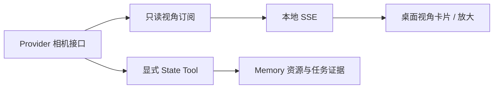

# 机器人视角

桌面右侧的视角卡片读取 Provider 提供的当前画面。首页跟随机器人选择，任务页跟随该任务的机器人。
默认相机来自 Provider；用户可以切换相机、放大画面或收起卡片。画面与采集时间来自实际 Provider。

## 可选 Provider 契约

接口位于 `tools/state/views.py`。Provider 可以独立实现 `RobotViewSource`，或通过 `provider.views` 暴露：

```python
class RobotViewSource(Protocol):
    def list_views(self) -> tuple[ViewSpec, ...]: ...
    def subscribe_view(self, view_id: str) -> AsyncGenerator[ViewFrame, None]: ...
```

| 数据 | 字段 |
| --- | --- |
| `ViewSpec` | `id`、显示名称 `label`、`is_default` |
| `ViewFrame` | `id`、Unix 秒时间戳 `captured_at`、`media_type`、编码图像字节 `data`、`width`、`height`、可选 `metadata` |

视角目录在装配时检查一次：相机 ID 唯一且非空、名称非空；有相机时恰好有一个默认相机。
目录是本次应用实例的能力声明。没有相机可返回空元组，也可不注册这个可选能力。
HTTP 入口检查请求的机器人/相机 ID；Provider 内部直接使用已验证的 ID。

图像使用浏览器可解码的编码格式，如 JPEG/PNG；时间戳表示实际采集时间，不能用接收或显示时间替代。
Provider 负责 SDK、颜色/畸变/尺寸转换和采集线程，通用 Runtime 不处理设备图像格式。
异步生成器在 `finally` 释放订阅；采集失败直接抛出异常，界面展示错误。
订阅必须只读，不得移动机器人、推进仿真或重置环境。

## 桌面装配

宿主初始化 Provider 后，把视角来源与已有的机器人 ID 关联：

```python
from primitive_vla.interfaces.web import create_app
from primitive_vla.interfaces.web.app import RobotProfile

app = create_app(
    agent,
    robots=(RobotProfile("robot-01", "your-robot-type", "实验室机器人"),),
    view_sources={"robot-01": provider.views},
)
```

`view_sources` 的机器人必须出现在 `robots` 中。宿主拥有 Provider 生命周期，负责初始化和关闭；
创建 Web 应用不会重新创建机器人。RoboCasa 装配已传入 `environment.views`，原启动命令保持不变。

传输复用本地 API 与桌面令牌认证：

- `GET /api/robots/{robot_id}/views` 返回视角目录。
- `GET /api/robots/{robot_id}/views/{view_id}/stream` 返回 SSE；`frame` 事件携带帧元数据及 Base64 图像。
- `view_error` 表示订阅失败，`view_closed` 表示来源结束；两者都关闭当前连接，等待用户点击重新连接。
- 客户端断开时关闭异步生成器。切换相机丢弃旧连接迟到的帧；放大窗口复用当前连接。

V1 采用低帧率图片预览，未引入视频编码、WebRTC 或新的服务依赖。

## 运行边界



预览不调用 Planning、Tool Router 或 Hook，不计入任务调用预算，也不逐帧持久化或唤醒 Agent。
Agent 需要图像进行决策或验证时，仍通过正式 State Tool 采集并记录资源引用。桌面画面不是 Verification 结论。

RoboCasa 在原有单个 MuJoCo/EGL 工作线程上渲染。空闲时定时采集；长动作运行期间通过步间回调采集，
目标每相机 3 FPS、JPEG 质量 80、边长不超过 512。渲染时间会影响实际帧率和仿真吞吐量，不承诺实时视频。
同相机的多个订阅共享采集，每个消费者的待取缓冲只存一帧；慢消费者跳过旧帧，不积累录像。
最后一个消费者退订后不再发起采集，已经开始的渲染会正常结束。预览故障只终止对应订阅，不改变动作结果。

收起、隐藏上下文面板、最小化窗口和关闭页面会退订。重新显示时订阅所选相机；错误状态需明确重连。
这些界面操作不取消机器人动作、不释放 Execution 控制占用。关闭整个应用仍遵循原有动作停止确认协议。

## 文件职责

| 路径 | 职责 |
| --- | --- |
| `tools/state/views.py` | 通用可选视角契约 |
| `providers/robocasa/views.py` | 订阅共享、限频、最新帧与退出清理 |
| `providers/robocasa/backend.py` | 原生渲染及动作步间回调 |
| `interfaces/web/views.py` | 目录检查、HTTP/SSE、连接清理 |
| `interfaces/web/static/components/robot-view.js`、`.css` | 独立桌面组件 |

主应用只负责装配和当前机器人选择；组件不进入任务时间线的重复渲染区域。新增其他机器人视角不修改 Planning。

## 已做验证

2026-11-12：106 项 Python 回归、17 项桌面测试通过。视角专门覆盖可选能力、目录校验、鉴权、
HTTP 断开清理、采集失败、共享采集、丢弃旧帧、相机切换、窗口可见性和任务刷新不重建预览。

本机 RTX 5090 的真实 `NavigateKitchen / target / seed=1` 检查：四路相机均输出 512×512 JPEG，
空闲预览约 2.9 FPS；动作第 10、20、31 步收到新帧，取消经过 `stop_unconfirmed → cancelled`，停在第 32 步。
只观看时仿真步数和 Memory 不变，退订后额外采集停止。该结果是本次运行观测，不是时延承诺或自主任务成功率。

真实 Electron/X11 窗口已检查画面、切换、放大、深浅主题、窄窗口和最小化退订。
本地报告与截图位于 Git 忽略的 `workspace/robot-view-check/`；验收没有调用模型或下载权重。
